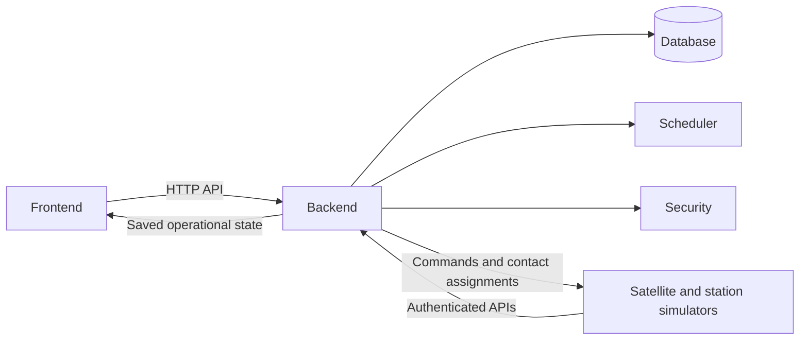

# Orbitron — Frontend Implementation Plan

**Upload location:** `frontend/plan.md`  
**Module:** Frontend  
**Plan version:** 1.0  
**Shared API contract:** `orbitron.v1`  
**Target:** A locally running frontend connected to the Orbitron backend.

---

## 1. Instructions to the implementing agent

You are implementing the frontend of Orbitron, a satellite downlink scheduling and secure ground-station sharing platform.

Read this entire document before creating files.

Your responsibility is to build the frontend described here. The backend, scheduler, simulator and security components are separate modules developed by other agents.

### Required behaviour

1. Implement the screens, interactions and API integration specified in this document.
2. Follow the exact field names, units, statuses and endpoint paths in the shared contract.
3. Keep frontend application files and dependencies inside `frontend/`.
4. Use the backend as the source of operational records and scheduling decisions.
5. Report missing backend capabilities as integration dependencies.
6. Keep this plan unchanged unless the project owner explicitly requests a revision.
7. Preserve other agents’ work.
8. Report what was implemented, what was verified and what remains blocked.

### Completion rule

Do not mark the frontend as fully integrated until it has been tested against the actual backend.

A successful build, working test fixtures or attractive screenshots alone do not establish integration.

---

## 2. Product purpose

Orbitron helps satellite operators:

- Submit requests to deliver satellite data before a deadline.
- Find compatible ground-station communication opportunities.
- View antenna bookings.
- Recover schedules after rain, outages and emergency requests.
- Use approved partner stations.
- Observe authorization and encrypted-transfer demonstrations.
- Compare the proposed scheduler with FIFO.
- Understand why requests were moved, blocked or rejected.

The frontend is an operations console. Its main purpose is to let a user understand the current network state and take useful actions.

### Important simulation requirement

The simulator behaves like an independent virtual satellite fleet.

It sends satellite records, telemetry, requests and transfer progress through backend interfaces. The backend validates and stores these records.

The frontend displays those backend records. It must never invent satellite positions, job completion, successful transfers or schedule changes.

Records retain their simulated provenance, including when real public orbital data is used to calculate movement.

---

## 3. Six-folder architecture and ownership

The repository has six application responsibility areas:

| Folder | Responsibility |
|---|---|
| `frontend/` | Browser interface, forms, visualizations and API client |
| `backend/` | HTTP APIs, persistence, authoritative application state and coordination |
| `scheduler/` | Contact selection, conflict prevention and rescheduling |
| `simulation/` | Virtual satellites, station behaviour, orbital movement and operational events |
| `security/` | Identity, authorization, scoped contact permissions and encryption demonstration |
| `docs/` | Setup, architecture, integration instructions, evaluation and final documentation |

### Communication boundaries



The frontend:

- Calls the backend only.
- Does not connect directly to the database.
- Does not import Python modules.
- Does not calculate orbital passes.
- Does not run scheduling algorithms.
- Does not communicate directly with simulated station gateways.
- Does not hold satellite payload decryption keys.

### Contract ownership

Sections 5–9 of this plan establish the initial shared interface contract.

The later backend, scheduler, simulation, security and documentation plans must adopt this contract.

Until a project-wide contract is deliberately published, this document is the reference for frontend-facing interfaces.

The backend owner must eventually export matching OpenAPI documentation. The documentation owner can publish a canonical copy, preserving the contract version and semantics.

An agent must not silently rename fields or invent an alternative endpoint.

---

## 4. Scope and implementation choices

### Frontend stack

Use:

- React.
- TypeScript with strict checking.
- Vite.
- React Router.
- TanStack Query for server state and polling.
- Plain CSS with shared design tokens.
- Lucide icons, if icons are needed.
- Vitest and React Testing Library.
- MSW for HTTP mocking in tests only.

Use compatible stable package versions and commit `package-lock.json`.

Do not introduce another framework, another package manager or a separate frontend server architecture.

### Local environment

| Component | Address or decision |
|---|---|
| Frontend | `http://localhost:5173` |
| Backend | `http://localhost:8000` |
| API prefix | `/api/v1` |
| Authentication | Backend-managed session cookie |
| Server updates | Polling every 2 seconds while the page is visible |
| Local database | Backend-owned SQLite for the initial portable prototype |
| Production database migration | Outside frontend scope |
| Public deployment | Outside this plan |

The SQLite choice is for a simple local launch. The frontend must not depend on the database engine, so another backend database can be introduced without redesigning the UI.

### Source folders

Create an understandable structure similar to:

```text
frontend/
├── plan.md
├── README.md
├── IMPLEMENTATION_REPORT.md
├── package.json
├── package-lock.json
├── index.html
├── vite.config.ts
├── tsconfig.json
├── .env.example
├── .gitignore
├── public/
└── src/
    ├── main.tsx
    ├── App.tsx
    ├── api/
    │   ├── client.ts
    │   ├── types.ts
    │   ├── queries.ts
    │   └── mutations.ts
    ├── app/
    │   ├── router.tsx
    │   └── providers.tsx
    ├── components/
    │   ├── layout/
    │   ├── feedback/
    │   ├── forms/
    │   ├── tables/
    │   └── timeline/
    ├── pages/
    ├── styles/
    ├── utils/
    └── tests/
```

Small variations are acceptable if responsibilities remain clear.

Do not create empty placeholder pages and claim completion.

---

## 5. Shared contract: conventions

### 5.1 Contract version

The backend health response and every operational snapshot must report:

```text
orbitron.v1
```

If a different version is returned, display an integration error and disable mutations.

### 5.2 Naming

Use:

- `snake_case` for API fields.
- Stable string IDs.
- Arrays for collections.
- Explicit `null` for unavailable nullable values.
- Boolean values for flags.
- Numbers for counts and measurements.

Do not use display names as record identifiers.

### 5.3 Units

| Value | Canonical unit |
|---|---|
| Data volume | Bytes |
| Data rate | Bits per second |
| Duration | Seconds |
| Latitude and longitude | Degrees |
| Altitude | Kilometres |
| Weather capacity factor | Number from `0` to `1` |

Conversions for display:

```text
1 MB = 1,000,000 bytes
1 GB = 1,000,000,000 bytes
1 Mbps = 1,000,000 bits per second
```

Label displayed units consistently.

Do not divide bytes by a rate measured in bits without accounting for the factor of eight.

### 5.4 Timestamps and clocks

All API timestamps must be ISO 8601 UTC strings ending in `Z`.

Orbitron has two different clocks:

1. **Server time:** real time, used for sessions, API operations and system connectivity.
2. **Simulation time:** operational time, used for satellite movement, passes, deadlines and simulated contacts.

The frontend must use the timestamp supplied by the backend for each purpose.

Do not use the browser’s current time to decide whether a simulated contact is active.

Display a timezone label next to operational timestamps. Use the browser timezone for readable display, with UTC available in a tooltip.

### 5.5 Ownership

The backend determines the current user’s organisation and permissions.

The frontend must not send an arbitrary owner organisation to claim ownership of a job.

Changing a dropdown must never grant access to another organisation.

### 5.6 State authority

The backend owns:

- Job status.
- Remaining data.
- Booking status.
- Contact authorization.
- Transfer results.
- Simulator connectivity.
- Schedule versions.
- Evaluation results.

The frontend may derive presentation values, such as a percentage from two backend counters. It must not derive new operational outcomes.

### 5.7 Schedule concurrency

Schedule-changing requests include `expected_schedule_version`.

If the backend returns a stale-version conflict:

1. Refresh the snapshot.
2. Explain that the schedule changed.
3. Let the user review and retry.
4. Do not silently repeat the mutation.

### 5.8 Idempotency

Send an `Idempotency-Key` header for state-changing requests.

Generate it with `crypto.randomUUID()`.

For a retry of the same uncertain request, preserve the same key and payload.

If the user changes the payload, create a new key.

Do not automatically retry state-changing requests after a network timeout.

---

## 6. Shared contract: data models

Implement matching TypeScript types in `src/api/types.ts`.

The following is the frontend-facing JSON contract. Backend implementations may have additional internal fields.

```ts
type ID = string;
type ISODateTime = string;

type Priority = "routine" | "high" | "emergency";
type Role = "operator" | "network_admin";

type JobStatus =
  | "pending"
  | "scheduled"
  | "active"
  | "completed"
  | "blocked"
  | "cancelled";

type ContactStatus =
  | "tentative"
  | "confirmed"
  | "active"
  | "completed"
  | "failed"
  | "cancelled";

type AuthorizationStatus =
  | "pending"
  | "allowed"
  | "denied"
  | "expired"
  | "revoked";

type OperationStatus =
  | "queued"
  | "running"
  | "succeeded"
  | "failed";

interface Reason {
  code: string;
  message: string;
  resource_ids: ID[];
}

interface Organization {
  id: ID;
  name: string;
}

interface User {
  id: ID;
  display_name: string;
  email: string;
  organization_id: ID;
  role: Role;
}

interface Session {
  user: User;
  csrf_token: string;
  expires_at: ISODateTime;
}

interface Position {
  latitude_deg: number;
  longitude_deg: number;
  altitude_km: number;
  observed_at: ISODateTime;
}

interface Satellite {
  id: ID;
  name: string;
  owner_org_id: ID;
  supported_bands: string[];
  max_downlink_rate_bps: number;
  max_parallel_contacts: number;
  onboard_bytes: number;

  operational_status:
    | "available"
    | "communicating"
    | "fault";

  telemetry_status:
    | "fresh"
    | "stale"
    | "never_seen";

  position: Position | null;
  last_telemetry_at: ISODateTime | null;

  source: "simulated";
  orbit_source: "public_tle" | "synthetic";
  orbit_epoch_at: ISODateTime | null;
}

interface Antenna {
  id: ID;
  name: string;
  supported_bands: string[];
  max_rate_bps: number;
  setup_seconds: number;
  status: "available" | "maintenance" | "offline";
}

interface Station {
  id: ID;
  name: string;
  owner_org_id: ID;

  latitude_deg: number;
  longitude_deg: number;
  min_elevation_deg: number;

  operational_status: "online" | "degraded" | "offline";
  connection_status: "connected" | "stale" | "disconnected";
  weather_capacity_factor: number;

  sharing_enabled: boolean;
  approved_partner_org_ids: ID[];

  antennas: Antenna[];
  last_heartbeat_at: ISODateTime | null;
}

interface Job {
  id: ID;
  satellite_id: ID;
  owner_org_id: ID;

  requested_bytes: number;
  delivered_bytes: number;
  remaining_bytes: number;

  priority: Priority;
  deadline_at: ISODateTime;
  allow_split: boolean;
  status: JobStatus;

  reasons: Reason[];
  created_at: ISODateTime;
  updated_at: ISODateTime;
}

interface Opportunity {
  id: ID;
  satellite_id: ID;
  station_id: ID;
  antenna_id: ID;
  band: string;

  start_at: ISODateTime;
  end_at: ISODateTime;
  predicted_rate_bps: number;
}

interface Contact {
  id: ID;
  job_id: ID;
  satellite_id: ID;
  station_id: ID;
  antenna_id: ID;
  opportunity_id: ID;
  band: string;

  window_start_at: ISODateTime;
  window_end_at: ISODateTime;

  setup_start_at: ISODateTime;
  start_at: ISODateTime;
  end_at: ISODateTime;

  expected_rate_bps: number;
  allocated_bytes: number;
  transferred_bytes: number;

  status: ContactStatus;
  authorization_status: AuthorizationStatus;
  schedule_version: number;
  reasons: Reason[];
}

interface ScheduleChange {
  id: ID;
  schedule_version: number;
  job_id: ID;
  old_contact_ids: ID[];
  new_contact_ids: ID[];
  reasons: Reason[];
  created_at: ISODateTime;
}

interface DisruptionEvent {
  id: ID;

  type:
    | "rain"
    | "station_outage"
    | "station_recovery";

  station_id: ID;
  capacity_factor: number | null;

  status: "pending" | "applied" | "failed";
  occurred_at: ISODateTime;
  operation_id: ID | null;
  reasons: Reason[];
}

interface Transfer {
  id: ID;
  contact_id: ID;
  owner_org_id: ID;
  partner_station_id: ID;

  status:
    | "queued"
    | "encrypting"
    | "forwarding"
    | "delivered"
    | "verification_failed"
    | "failed";

  total_bytes: number;
  forwarded_bytes: number;

  ciphertext_sha256: string | null;
  expected_plaintext_sha256: string | null;
  owner_plaintext_sha256: string | null;

  integrity_status: "pending" | "verified" | "failed";
  owner_decryption_status: "pending" | "succeeded" | "failed";

  partner_key_access: "not_provisioned" | "unknown";
  reasons: Reason[];
}

interface SecurityCheck {
  id: ID;

  test_case:
    | "expired_authorization"
    | "wrong_station"
    | "tampered_payload";

  status: "queued" | "running" | "completed" | "failed";

  passed: boolean | null;
  expected_outcome: string;
  observed_outcome: string | null;
  reasons: Reason[];
}

interface SchedulerMetrics {
  requested_bytes: number;
  delivered_before_deadline_bytes: number;
  total_jobs: number;
  on_time_jobs: number;
  urgent_jobs: number;
  urgent_on_time_jobs: number;
  resource_conflicts: number;
  scheduling_duration_ms: number;
  bookings_changed: number;
}

interface Evaluation {
  id: ID;
  scenario_id: ID;
  workload_id: ID;
  event_trace_id: ID;

  status: "queued" | "running" | "completed" | "failed";

  fifo: SchedulerMetrics | null;
  optimized: SchedulerMetrics | null;

  reasons: Reason[];
}

interface Operation {
  id: ID;

  kind:
    | "schedule"
    | "disruption"
    | "simulation"
    | "transfer"
    | "security_check"
    | "evaluation";

  status: OperationStatus;
  resource_id: ID | null;

  submitted_at: ISODateTime;
  completed_at: ISODateTime | null;
  reasons: Reason[];
}

interface AuditEntry {
  id: ID;
  actor_name: string;
  action: string;
  resource_type: string;
  resource_id: ID | null;
  outcome: "allowed" | "denied" | "succeeded" | "failed";
  message: string;

  timestamp: ISODateTime;
  clock_basis: "server" | "simulation";
}

interface SimulatorState {
  connection_status: "connected" | "stale" | "disconnected";
  run_state: "running" | "paused" | "stopped";
  speed_multiplier: number;
  last_heartbeat_at: ISODateTime | null;
}

interface Scenario {
  id: ID;
  name: string;
  seed: number;
  start_at: ISODateTime;
  end_at: ISODateTime;
  ready_for_evaluation: boolean;
}

interface Snapshot {
  meta: {
    contract_version: "orbitron.v1";
    mode: "simulation";

    state_revision: number;
    schedule_version: number;

    server_time: ISODateTime;
    simulation_time: ISODateTime;

    visible_start_at: ISODateTime;
    visible_end_at: ISODateTime;

    services: {
      scheduler: "ready" | "unavailable";
      security: "ready" | "unavailable";
    };
  };

  user: User;
  organizations: Organization[];
  satellites: Satellite[];
  stations: Station[];
  jobs: Job[];
  opportunities: Opportunity[];
  contacts: Contact[];
  schedule_changes: ScheduleChange[];
  events: DisruptionEvent[];
  transfers: Transfer[];
  security_checks: SecurityCheck[];
  evaluations: Evaluation[];
  operations: Operation[];
  audit: AuditEntry[];

  simulator: SimulatorState;
  scenario: Scenario | null;
}

interface ApiError {
  error: {
    code: string;
    message: string;

    details: {
      field: string;
      message: string;
    }[];

    request_id: string;
  };
}
```

### Model rules

- All top-level snapshot collections are present, including when empty.
- All IDs referenced by visible records must be resolvable within the visible dataset.
- Antenna IDs must be globally unique.
- `requested_bytes = delivered_bytes + remaining_bytes`.
- Partial delivery is represented by counters, not a separate invented job status.
- A blocked job can retain positive remaining data.
- A completed job has zero remaining bytes.
- `capacity_factor` applies to rain events; it is `null` for other event types.
- Job deadlines and contact times use simulation time.
- Session and operation timestamps use server time.
- The backend supplies audit `clock_basis`.
- The backend calculates telemetry freshness.
- The frontend displays missing position as unavailable, never as latitude `0`, longitude `0`.
- The frontend must not translate a missing measurement into a successful outcome.

### Reason codes to support

The frontend should render the backend’s human-readable `message`.

Recognize these codes for helpful icons or grouping:

```text
NO_VISIBLE_PASS
BAND_MISMATCH
STATION_OFFLINE
ANTENNA_BUSY
SETUP_CONFLICT
DEADLINE_UNREACHABLE
INSUFFICIENT_CAPACITY
PARTNER_NOT_APPROVED
AUTHORIZATION_DENIED
ACTIVE_CONTACT_PROTECTED
PARTIAL_DELIVERY
WEATHER_DEGRADED
EMERGENCY_REPLAN
SCHEDULER_UNAVAILABLE
STALE_SCHEDULE
```

Unknown reason codes must still display their message.

---

## 7. Shared contract: HTTP endpoints

All paths below are relative to:

```text
http://localhost:8000/api/v1
```

### 7.1 Authentication and state

| Method | Path | Request | Success |
|---|---|---|---|
| GET | `/health` | None | `200` health object |
| POST | `/auth/login` | Email and password | `200 Session`, session cookie |
| GET | `/auth/session` | Session cookie | `200 Session` |
| POST | `/auth/logout` | Session cookie and CSRF token | `204`, cookie cleared |
| GET | `/snapshot` | Session cookie | `200 Snapshot` |
| GET | `/operations/{operation_id}` | Session cookie | `200 Operation` |

Health response:

```json
{
  "service": "orbitron-backend",
  "contract_version": "orbitron.v1",
  "status": "ready"
}
```

`status` can also be `degraded`.

A reachable backend with an unavailable scheduler can report degraded health. Operational service availability remains visible in the snapshot.

Login request:

```json
{
  "email": "operator@example.test",
  "password": "value-entered-by-user"
}
```

The account above is illustrative. The backend setup instructions must supply actual local demo accounts.

Do not hardcode credentials into the frontend.

### 7.2 Job creation

```text
POST /jobs
Success: 201 Job
```

Request:

```json
{
  "satellite_id": "sat-a-001",
  "data_bytes": 1000000000,
  "deadline_at": "2026-10-31T08:30:00Z",
  "priority": "high",
  "allow_split": true
}
```

The timestamp is an example, not a runtime default.

The backend derives `owner_org_id` from the authenticated session and validates satellite ownership.

Creating a job does not imply that it has been scheduled.

### 7.3 Scheduling

```text
POST /schedule/runs
Success: 202 Operation
```

Request:

```json
{
  "algorithm": "optimized",
  "expected_schedule_version": 7
}
```

The user-facing schedule action uses `optimized`.

FIFO is used through the evaluation endpoint.

### 7.4 Disruption events

```text
POST /events
Success: 202 Operation
```

Rain request:

```json
{
  "type": "rain",
  "station_id": "gs-b-001",
  "capacity_factor": 0.4,
  "expected_schedule_version": 7
}
```

Outage request:

```json
{
  "type": "station_outage",
  "station_id": "gs-b-001",
  "capacity_factor": null,
  "expected_schedule_version": 7
}
```

Recovery uses `station_recovery` and `capacity_factor: null`.

The backend applies the event and initiates the appropriate replanning process.

The frontend must not rewrite bookings itself.

### 7.5 Simulation controls

```text
POST /simulation/actions
Success: 202 Operation
```

Allowed request forms:

```json
{
  "action": "pause"
}
```

```json
{
  "action": "resume"
}
```

```json
{
  "action": "step",
  "step_seconds": 60
}
```

```json
{
  "action": "reset",
  "seed": 42
}
```

Rules:

- Only a network administrator can issue these actions.
- `step` is available only while paused.
- Reset requires a confirmation dialog.
- Reset reinitializes the demo scenario through backend/simulator coordination.
- The frontend does not generate replacement records.
- A disconnected simulator produces a clear unavailable response.

### 7.6 Secure transfer

```text
POST /transfers
Success: 202 Operation
```

Request:

```json
{
  "contact_id": "contact-001"
}
```

The backend validates that the contact is executable, authorized and suitable for the transfer.

If the contact cannot execute, show the backend’s rejection reason.

### 7.7 Security checks

```text
POST /security/checks
Success: 202 Operation
```

Request:

```json
{
  "test_case": "tampered_payload",
  "contact_id": "contact-001"
}
```

Other allowed test cases:

- `expired_authorization`
- `wrong_station`

These are controlled local demonstration tests.

The backend/security modules must execute the actual checks. The frontend only requests them and displays the returned evidence.

### 7.8 Evaluation

```text
POST /evaluations
Success: 202 Operation
```

Request:

```json
{
  "scenario_id": "scenario-001"
}
```

The backend must run FIFO and the proposed scheduler against the same saved workload and disruption trace.

Evaluation must not overwrite the live operational schedule.

The frontend must not calculate invented comparison results.

### 7.9 Snapshot range

`GET /snapshot` accepts optional:

```text
from=<UTC timestamp>
to=<UTC timestamp>
```

Both must be supplied together.

Without them, the backend returns a default operational view beginning 15 simulation minutes before the current time and ending six simulation hours after it.

The response reports the actual range in:

- `meta.visible_start_at`
- `meta.visible_end_at`

The initial MVP can return the complete bounded demonstration dataset without pagination:

- Up to 120 satellites.
- Up to 12 stations.
- Up to 1,000 jobs.
- Contacts and opportunities within the requested time range.
- Recent operational records appropriate to the demo.

Do not silently discard records in the browser to create misleading totals.

---

## 8. Authentication, permissions and browser security

### 8.1 Session handling

Use backend-managed session cookies.

Every API request includes:

```ts
credentials: "include"
```

The backend sets its session cookie as HttpOnly.

The frontend stores the returned CSRF token in memory.

Authenticated state-changing requests include:

```text
X-CSRF-Token: <current token>
```

The backend/security plans must implement matching server-side validation.

### 8.2 Session lifecycle

On application startup:

1. Check `/health`.
2. Verify the contract version.
3. Request `/auth/session`.
4. If authenticated, load `/snapshot`.
5. If unauthenticated, show the login screen.

On `401`:

- Stop protected polling.
- Clear session state and cached protected data.
- Return to login with a session-expired explanation.

On logout:

- Call the logout endpoint.
- Clear session state and cached application records.
- Return to login.

### 8.3 Roles

| Capability | Operator | Network administrator |
|---|---:|---:|
| View permitted operational records | Yes | Yes |
| Submit a request for an owned satellite | Yes | Yes, subject to backend policy |
| Request scheduling | Yes, subject to backend policy | Yes |
| Start a permitted transfer | Yes | Yes |
| Inject disruptions | No | Yes |
| Control/reset simulation | No | Yes |
| Run controlled security checks | No | Yes |
| Run evaluation | No | Yes |

UI visibility is a convenience. The backend must enforce every permission.

A network administrator may see operational metadata permitted by the demo policy. This role does not imply access to payload decryption keys.

### 8.4 Credentials and payloads

Never place the following in browser code, frontend environment variables or logs:

- GitHub tokens.
- Gateway service credentials.
- Payload decryption keys.
- Encryption master secrets.
- Session cookies.
- Passwords.

The secure-transfer screen displays metadata and verification results. It does not decrypt payload files in the browser.

### 8.5 CORS

The backend must explicitly allow:

```text
http://localhost:5173
```

with credential support.

Use the same hostname consistently. Do not mix `localhost` and `127.0.0.1` in the default configuration.

---

## 9. API client behaviour

Implement one shared API client.

Do not scatter raw `fetch()` calls throughout page components.

### Client responsibilities

- Read the configured API base URL.
- Include cookies.
- Attach CSRF and idempotency headers when required.
- Parse JSON success and error responses.
- Handle `204` without attempting JSON parsing.
- Support request cancellation.
- Distinguish network failures from server rejections.
- Expose typed API errors.
- Avoid logging sensitive request bodies.

### Error behaviour

| Situation | Required UI response |
|---|---|
| Backend unreachable | Connection banner and retry action |
| `401` | Return to login |
| `403` | Permission explanation |
| `409` | Conflict explanation; refresh relevant state |
| `422` | Map validation details to form fields |
| `429` | Explain rate limiting and respect retry guidance |
| `5xx` | Preserve existing data, show failure and retry |
| Contract mismatch | Disable mutations and show integration error |
| Malformed response | Integration error; do not invent default records |

Backend validation errors must use the agreed `ApiError` shape, including normalization of framework-generated validation errors.

### Polling

- Poll `/snapshot` every two seconds while the application is visible and authenticated.
- Avoid overlapping requests.
- Pause background polling when the browser tab is hidden.
- Refresh immediately when the tab becomes visible.
- Cancel obsolete requests.
- Prevent an older response from overwriting a newer `state_revision`.
- Invalidate/refetch after successful mutations.
- Retain the last successful snapshot during temporary failures.
- Display its age and stale status.

An unavailable simulator is different from an unavailable backend. Show these states separately.

### Asynchronous operations

For endpoints returning `202 Operation`:

1. Display that the operation was accepted.
2. Track the returned operation ID.
3. Observe its status in subsequent snapshots.
4. If necessary, retrieve `/operations/{operation_id}`.
5. Show completion only when its status becomes `succeeded`.
6. Show failure reasons when its status becomes `failed`.

A long-running operation remains “Running”. A browser timeout alone does not prove that the backend operation failed.

Disable duplicate submissions while the same operation is pending.

---

## 10. Visual design

The repository reference contained an empty frontend plan and no implemented design assets. Use the dashboard concept below as the initial design specification.

If the project owner later supplies a reference design, preserve the functional and integration requirements while adapting the visual treatment.

### 10.1 Direction

Build a calm, readable mission-operations console.

Use:

- A dark navy background.
- Slightly lighter panels.
- Clear table typography.
- Restrained accent colours.
- Strong visual hierarchy.
- Compact status badges.
- Meaningful operational graphics.

### 10.2 Suggested tokens

```css
--color-bg: #07111f;
--color-panel: #111e30;
--color-panel-raised: #17273d;
--color-border: #293b54;

--color-text: #edf3fc;
--color-muted: #a4b4ca;

--color-accent: #8b80ff;
--color-success: #35d4b0;
--color-warning: #f3bd62;
--color-danger: #ff7f8a;

--radius-panel: 14px;
--radius-control: 8px;
```

Check text contrast before finalizing.

Use a system font stack. The application must remain usable without downloading fonts.

### 10.3 Application shell

Desktop structure:

```text
┌─────────────────────────────────────────────────────────────┐
│ Orbitron        Simulation time        User / organisation   │
├──────────────┬──────────────────────────────────────────────┤
│ Overview     │ Page title                  Primary action   │
│ Schedule     │ Connection / stale-data banner when needed   │
│ Requests     ├──────────────────────────────────────────────┤
│ Recovery     │                                              │
│ Security     │              Page content                    │
│ Evaluation   │                                              │
│ Audit        │                                              │
└──────────────┴──────────────────────────────────────────────┘
```

Desktop sidebar width: approximately 224 pixels.

Show:

- Product name: **Orbitron**.
- A clear **Simulation** badge.
- Operational simulation time.
- Signed-in organisation.
- User menu and logout.

Keep API URLs, raw configuration and service debugging details inside a collapsed diagnostics area.

### 10.4 Responsive behaviour

- Desktop: sidebar plus main workspace.
- Tablet: collapsible navigation.
- Mobile: navigation drawer, stacked cards and horizontally scrollable timelines/tables.

At 360 pixels wide, forms and primary actions must remain usable.

### 10.5 Status presentation

Use colour together with text or icons.

Examples:

- Scheduled: purple/blue.
- Active: teal.
- Emergency: coral.
- Blocked or degraded: amber.
- Completed: green.
- Cancelled or unavailable: muted.

Do not rely on colour alone.

Avoid decorative 3D globes, animated starfields or unrelated charts. A map can be added later if it materially helps operations and time remains.

---

## 11. Routes and screens

Implement these routes:

| Route | Screen |
|---|---|
| `/login` | Authentication |
| `/` | Overview |
| `/schedule` | Station and antenna timeline |
| `/requests` | Downlink requests |
| `/recovery` | Disruptions and schedule changes |
| `/security` | Secure sharing and transfer evidence |
| `/evaluation` | FIFO comparison |
| `/audit` | Activity and decision history |

Unknown routes display an application-styled “Page not found” screen.

### 11.1 Login

Include:

- Email.
- Password.
- Sign-in button.
- Inline validation.
- Loading state.
- Server rejection message.
- Backend connection feedback.

Do not fabricate a logged-in user if authentication fails.

Do not include a role selector that changes permissions locally.

### 11.2 Overview

Purpose: understand the current network state.

Display:

- Registered satellites.
- Pending jobs.
- Active contacts.
- Jobs approaching deadlines.
- Blocked jobs.
- Delivered bytes from visible job records.

Define “approaching deadline” as an incomplete, non-cancelled job with a deadline within the next 30 simulation minutes.

Display two operational tables:

**Fleet table**

- Satellite.
- Owner.
- Operational status.
- Supported bands.
- Onboard data.
- Telemetry freshness.
- Last observation.

**Station table**

- Station.
- Owner.
- Operational status.
- Gateway connectivity.
- Antenna count.
- Weather capacity factor.
- Sharing availability.

Selecting a satellite or station opens a detail drawer using the actual record.

Satellite and station catalogues are read-only in this initial frontend scope. The simulator/backend handle registration.

### 11.3 Schedule

Purpose: inspect and understand bookings.

Build a timeline with:

- One row per antenna.
- Rows grouped by station.
- Labelled time axis.
- Setup intervals.
- Contact blocks.
- A simulation-time indicator.
- Satellite, station, priority and status filters.
- Current schedule version.
- “Run scheduler” action.

Render positions using:

```text
left =
  (contact_start - visible_start)
  / (visible_end - visible_start)

width =
  (contact_end - contact_start)
  / (visible_end - visible_start)
```

Clip rendering to the viewport without modifying underlying timestamps.

Draw setup separately from the communication interval.

When a satellite is selected, its returned opportunities may be shown as subtle background windows. Do not draw all fleet opportunities at once.

Selecting a contact shows:

- Satellite and job.
- Station and antenna.
- Band.
- Visibility window.
- Setup and booked interval.
- Allocated data.
- Transferred data.
- Expected rate.
- Contact status.
- Authorization status.
- Decision reasons.
- Schedule version.

Do not permit drag-to-reschedule in the MVP.

If the backend returns overlapping bookings, visibly flag the condition. Do not shift blocks to hide the conflict.

Keep the chosen viewport stable while the user inspects it. Provide an explicit “Follow simulation time” action.

### 11.4 Requests

Purpose: submit and track downlink jobs.

Request form:

- Satellite selector restricted to permitted satellites.
- Data volume.
- MB/GB unit selector.
- Deadline.
- Priority.
- Allow multiple contacts checkbox.
- Submit action.

Validation:

- Satellite is required.
- Data volume is positive.
- Converted bytes are a safe positive integer.
- Maximum request is 1,000,000,000,000 bytes for the local MVP.
- Deadline must be later than the current simulation time.
- If available onboard data is lower, explain the issue.
- Backend validation remains authoritative.

Default the deadline relative to simulation time, not to a fixed historical date.

After submission:

- Keep the returned job ID.
- Refresh the snapshot.
- Show the actual server status.
- Offer navigation to its schedule or explanation.

Requests table:

- Job ID.
- Satellite.
- Priority.
- Requested/delivered/remaining data.
- Deadline.
- Status.
- Blocking or scheduling reason.

An emergency is submitted as a real job with `priority: "emergency"`. Do not create a separate fake emergency record.

### 11.5 Recovery

Purpose: inspect disruptions and resulting decisions.

Administrator controls:

- Select a station.
- Apply rain with a capacity factor.
- Trigger an outage.
- Restore the station.

Explain that the weather factor represents the prototype’s configured capacity model.

Also provide a link to submit an emergency request.

Display:

- Event status.
- Affected station.
- Event time.
- Processing operation.
- Schedule version before and after.
- Changed jobs.
- Old and new contacts.
- Backend decision reasons.

Build the before/after view from `schedule_changes`.

Never invent an old booking from the current schedule.

If a change has no old contact, label it “New assignment”.

If a change has no replacement, label it “Unassigned” and display the reason.

Preserve the most recent selected event while polling.

### 11.6 Security

Purpose: explain approved sharing and show real demonstration evidence.

Display:

- Job owner.
- Receiving station and owner.
- Whether it is a partner contact.
- Authorization status.
- Transfer state.
- Forwarded and total bytes.
- Integrity result.
- Owner decryption result.
- Available hashes.

Start-transfer action:

- Available for permitted users.
- Uses a selected eligible contact.
- Calls the backend transfer endpoint.
- Does not handle plaintext files or encryption keys.

Security checks:

- Expired authorization.
- Wrong station.
- Modified encrypted payload.

Display each check’s:

- Expected result.
- Observed result.
- Whether the check passed.
- Backend reasons.

Distinguish:

- “The security test ran successfully.”
- “The expected rejection actually occurred.”

A test operation completing does not automatically mean the security control passed.

For partner key access, use wording such as:

> Demo configuration: partner gateway was not provisioned a payload decryption key.

Do not claim that the browser has independently proved the absence of keys.

Show pending or unavailable evidence honestly.

### 11.7 Evaluation

Purpose: compare FIFO and the proposed scheduler on equal inputs.

Require a saved scenario with `ready_for_evaluation: true`.

Show:

- Scenario name.
- Workload ID.
- Event trace ID.
- Evaluation status.

Comparison table:

| Metric | FIFO | Proposed scheduler |
|---|---|---|
| Requested data | Actual result | Actual result |
| Data delivered before deadlines | Actual result | Actual result |
| Jobs completed on time | Actual result | Actual result |
| Urgent jobs completed on time | Actual result | Actual result |
| Resource conflicts | Actual result | Actual result |
| Scheduling time | Actual result | Actual result |
| Bookings changed | Actual result | Actual result |

Use a simple grouped bar chart only when results are available.

Calculate percentages only when a valid denominator exists.

If the baseline value is zero, show the absolute difference or “Not applicable” rather than an infinite improvement percentage.

If one algorithm failed, display the failure. Do not fill its result with zero.

### 11.8 Audit

Purpose: explain operational activity.

Provide filters for:

- Outcome.
- Resource type.
- Actor.
- Search text.

Display:

- Timestamp and clock basis.
- Actor.
- Action.
- Resource.
- Outcome.
- Human-readable message.

Use text-safe rendering. Do not inject backend messages as HTML.

Do not expose credentials or raw sensitive request bodies.

---

## 12. Shared components

Build reusable components for:

- Application shell.
- Page title and actions.
- Status badge.
- Data volume.
- Data rate.
- Timestamp with timezone.
- Empty state.
- Loading skeleton.
- Error panel.
- Connection banner.
- Confirmation dialog.
- Detail drawer.
- Reason list.
- Operational table.
- Operation progress indicator.

Components should receive records and callbacks. They should not contain hidden scheduling rules.

### Form and interaction rules

- Every input has a visible label.
- Validation errors appear next to their fields.
- Buttons communicate loading state.
- Keyboard focus remains visible.
- Dialogs trap focus and restore it when closed.
- Escape closes dismissible overlays.
- Reset requires explicit confirmation.
- Successful submission does not erase evidence before the user can inspect it.
- Polling must not clear an in-progress form.

### Empty states

Use meaningful messages:

- “No satellite records received yet.”
- “No station bookings in this time range.”
- “No requests match these filters.”
- “No secure transfer has been started.”
- “Run an evaluation to see measured results.”

Do not show illustrative operational records as if they were live.

---

## 13. Simulation interaction requirements

The UI must visibly support the independent simulator model.

### Required observations

When the simulator runs:

1. Satellite observations change in backend records.
2. New telemetry appears with updated timestamps.
3. Data backlog and job counters change according to reported events.
4. Transfers advance only when backend-confirmed execution occurs.
5. Rain and outages affect subsequent scheduling and transfer results.
6. Pausing the simulator freezes operational time and movement.
7. Disconnecting the simulator produces a connectivity warning.

### Controls

Administrator controls may appear in a compact simulation toolbar.

Show:

- Running/paused/stopped.
- Connection status.
- Simulation time.
- Speed multiplier.
- Pause/resume.
- Step 60 seconds.
- Reset scenario.

Keep “paused” and “disconnected” visually distinct.

The frontend must not implement `setInterval()` logic that creates satellite movement or decreases remaining data.

A timer may trigger API polling. It may not generate operational outcomes.

---

## 14. Two-round execution workflow

### Preparation before parallel implementation

The project owner distributes the same shared contract to all agents.

The backend owner confirms:

- API prefix.
- Session behaviour.
- Snapshot structure.
- Endpoint request/response shapes.
- Contract version.

All agents work from the same agreed repository baseline.

### Round 1: working core

The three primary tasks are:

| Agent | Main responsibility |
|---|---|
| Agent 1 | Frontend |
| Agent 2 | Backend and database |
| Agent 3 | Scheduler |

Frontend implementation order:

1. Create the React/TypeScript project.
2. Add design tokens and application shell.
3. Define the shared TypeScript types.
4. Implement the API client and session handling.
5. Implement overview.
6. Implement request creation and request list.
7. Implement antenna timeline.
8. Implement scheduler operation tracking.
9. Build remaining screens against their declared interfaces.
10. Clearly mark unavailable backend capabilities.

Fixtures may be used in automated tests. They must not silently replace API responses in the running app.

### Round 1 gate

Verify against the backend:

- Login works.
- Satellite and station records load.
- A request is saved.
- The scheduler returns actual assignments.
- The timeline displays those assignments.
- Refreshing the browser preserves backend-owned records.
- Errors and blocked requests are visible.

### Round 2: realistic behaviour and integration

The main new tasks are:

| Agent | Main responsibility |
|---|---|
| Agent 1 | Simulation, plus fixes to their frontend integration |
| Agent 2 | Security, plus fixes to their backend integration |
| Agent 3 | Documentation and final integration coordination |

Frontend work during this round:

- Connect simulator controls and live records.
- Complete recovery views.
- Complete secure transfer and security-check views.
- Complete evaluation.
- Verify permission handling.
- Verify stale and disconnected states.
- Polish responsive layout.
- Fix issues found by end-to-end testing.

The documentation/integration owner coordinates the final root launcher. The frontend agent supplies its exact startup command and prerequisites.

### End-of-round launch condition

The project is ready to run locally after Round 2 only when the integration gates pass.

If a module remains unavailable, report the exact dependency. Do not claim that two completed rounds automatically guarantee a functioning application.

---

## 15. Acceptance scenarios

Verify these scenarios with real backend responses.

| ID | Scenario | Expected frontend behaviour |
|---|---|---|
| F01 | Backend is stopped | Connection error and retry; no invented records |
| F02 | Invalid credentials | Login rejected with readable feedback |
| F03 | Session expires | Protected state cleared; login shown |
| F04 | Valid request submitted | Returned job appears with server status |
| F05 | Request cannot meet deadline | Blocking reason is visible |
| F06 | Scheduler creates bookings | Contacts appear on correct antenna rows |
| F07 | Schedule version changes | Stale mutation is rejected and state refreshed |
| F08 | Rain is applied | Event and actual resulting changes appear |
| F09 | Station goes offline | Affected contacts and recovery decisions appear |
| F10 | Emergency request is submitted | Actual priority adjustment and consequences appear |
| F11 | Simulator is paused | Operational clock and records stop advancing |
| F12 | Simulator disconnects | Connectivity warning; stale data retained |
| F13 | Partial transfer occurs | Delivered and remaining counters match backend |
| F14 | Partner transfer succeeds | Owner verification and delivery evidence appear |
| F15 | Authorization expires | Rejection is displayed; transfer is not labelled delivered |
| F16 | Payload is modified | Integrity failure is visible |
| F17 | Evaluation completes | Both measured results and shared workload identifiers appear |
| F18 | API contract differs | Mutations disabled; contract error shown |
| F19 | User lacks permission | Controls restricted and server rejection handled |
| F20 | Dataset contains 120 satellites | Tables, filters and timeline remain usable |
| F21 | Browser reloads | Saved operational records are restored from backend |
| F22 | Mobile-width viewport | Navigation, forms and primary actions remain usable |

A frontend agent cannot independently certify scheduler correctness or encryption implementation. It must verify that the UI faithfully exposes the corresponding backend results.

---

## 16. Verification requirements

### Automated checks

Implement meaningful tests for:

1. Byte/rate formatting and unit conversion.
2. Deadline conversion between displayed local time and UTC.
3. Login and session-expiration behaviour.
4. Request validation and exact submitted payload.
5. API error rendering.
6. Asynchronous operation tracking.
7. Stale schedule handling.
8. Timeline placement and clipping.
9. Missing telemetry and empty collections.
10. Transfer integrity failure rendering.
11. Evaluation with a zero baseline.
12. Older snapshots not overwriting newer state.

Use MSW to mock HTTP in tests.

Keep test fixtures separate from runtime application data.

### Build verification

Provide and run:

```text
npm run typecheck
npm run test
npm run build
```

The `test` script must terminate after the suite rather than waiting indefinitely in watch mode.

### Manual verification

Run the application against the actual backend.

Check:

- All routes.
- Browser refresh.
- Keyboard navigation.
- Narrow viewport.
- Long satellite/station names.
- Empty datasets.
- Failed mutations.
- Backend restart.
- Simulator pause/disconnection.
- Actual scenario walkthrough.

If browser automation is available, use it. Otherwise, record the manual verification performed.

Do not report checks that were not run.

---

## 17. Local setup and commands

Create `.env.example`:

```dotenv
VITE_API_BASE_URL=http://localhost:8000/api/v1
```

Only non-secret browser configuration belongs in `VITE_*` variables.

Required frontend scripts:

```text
npm run dev
npm run typecheck
npm run test
npm run build
npm run preview
```

`npm run dev` must bind to port `5173` with strict port handling.

If the port is occupied, fail clearly instead of silently moving to a different port that the backend CORS configuration does not allow.

Use a Node.js release compatible with the selected Vite version. Record the exact tested Node and npm versions in the README.

Expected commands from a fresh checkout:

```text
cd frontend
npm ci
npm run dev
```

The README must explain creating `.env.local` from `.env.example`.

Backend and simulator startup commands belong to their owners’ documentation.

The final integration owner may provide a root-level launcher that starts the required processes. Do not invent or claim that launcher exists before it has been implemented.

---

## 18. Deliverables

The frontend agent must provide:

1. Complete frontend source.
2. Committed dependency lockfile.
3. `.env.example`.
4. Setup and usage README.
5. Meaningful automated tests.
6. Verified production build.
7. `IMPLEMENTATION_REPORT.md`.

The implementation report must contain:

```text
Implemented screens:
API endpoints integrated:
Contract version:
Checks run and actual results:
Manual/browser verification:
Known limitations:
Backend dependencies still missing:
Exact local startup command:
```

Do not include credentials in the report.

### Final handover checklist

- [ ] Product name is Orbitron.
- [ ] Runtime API calls use the agreed prefix.
- [ ] Runtime data comes from the backend.
- [ ] Satellite records retain simulated provenance.
- [ ] Simulation time and server time are handled separately.
- [ ] Request and response fields match this contract.
- [ ] Sessions and CSRF handling match the backend.
- [ ] No payload keys or service credentials enter the browser.
- [ ] Every operational action shows pending, success and failure states.
- [ ] Scheduling and security results are never fabricated.
- [ ] Browser refresh restores saved backend records.
- [ ] Frontend builds and its tests pass.
- [ ] Missing dependencies are explicitly documented.
- [ ] Other modules and this plan remain unchanged.

---

## 19. Out of scope for this frontend

Do not spend implementation time on:

- Public hosting.
- Satellite command transmission.
- Production agency integrations.
- Frontend orbital propagation.
- Frontend schedule optimization.
- Browser-based payload decryption.
- A marketing landing page.
- Billing or service-credit accounting.
- Drag-and-drop schedule editing.
- Mandatory 3D visualizations.
- WebSockets before polling is working.
- Replacing missing backend functionality with staged successes.

Complete the operational workflow first.

---

## 20. Implementation references

Use official documentation when checking framework behaviour:

- [Vite getting started](https://vite.dev/guide/)
- [Vite environment variables](https://vite.dev/guide/env-and-mode)
- [FastAPI CORS configuration](https://fastapi.tiangolo.com/tutorial/cors/)

These references explain tool behaviour. The Orbitron interfaces defined in this document remain the project contract.
