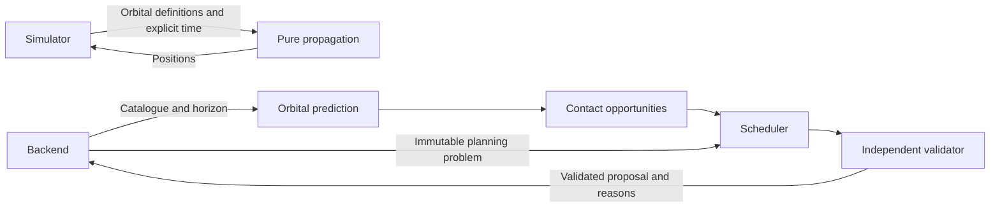

# Orbitron — Scheduler Implementation Plan

**Upload location:** `scheduler/plan.md`  
**Module:** Scheduler and orbital prediction  
**Plan version:** 1.0  
**Shared API contract:** `orbitron.v1`  
**Target:** A locally running Python module that predicts satellite contacts and produces valid, explainable schedules.

---

## 1. Instructions to the implementing agent

You are implementing Orbitron’s scheduling and orbital prediction module.

Your module determines:

1. Where simulated satellites are at a specified time.
2. When satellites are visible to ground stations.
3. Which communication opportunities are compatible with each job.
4. Which assignments can coexist without resource conflicts.
5. How a schedule should change after disruptions or emergency requests.
6. Why work remains unassigned.

### Read before implementation

Read:

1. Repository-level instructions, including any `AGENTS.md`.
2. `frontend/plan.md`.
3. `backend/plan.md`.
4. This complete document.

Preserve the public contract established by the frontend and backend plans.

### Ownership

Implement application files inside `scheduler/`.

Do not edit other modules or their plans.

Do not implement:

- HTTP routes.
- Database persistence.
- Browser components.
- Authentication endpoints.
- Station gateway processes.
- Payload encryption.

The backend calls your functions and owns persistence.

The simulator may reuse your pure orbital propagation function.

### Completion rule

A schedule is acceptable only after independent validation.

Do not claim success merely because the optimizer returned assignments.

Do not call a solution optimal unless the solver actually established optimality for the relevant objective.

---

## 2. Module responsibilities and boundaries

The module has four main responsibilities.

| Responsibility | Output |
|---|---|
| Orbital propagation | Satellite positions at a requested simulation time |
| Opportunity prediction | Satellite-to-station visibility windows |
| Scheduling | Compatible, conflict-free booking proposals |
| Explanation and validation | Reasons, diagnostics and verified constraints |

### Required architecture



### Authority

Your module proposes assignments.

The backend:

- Confirms that planning inputs remain current.
- Generates contact record IDs.
- Persists schedule versions.
- Requests station confirmations.
- Enforces execution authorization.
- Accepts delivery reports.

A proposed booking does not prove that a station confirmed it or that data was delivered.

---

## 3. Technology and execution model

Use:

- Python compatible with the backend’s tested Python version.
- Skyfield with its SGP4 support for orbital calculations.
- Google OR-Tools CP-SAT for constrained scheduling.
- Standard-library data structures where practical.
- Pytest for verification.

Pin compatible dependency versions.

The module runs locally. It does not require a separate server.

### Required properties

Functions must:

- Receive explicit inputs.
- Return JSON-compatible values.
- Avoid modifying their input objects.
- Avoid database access.
- Avoid HTTP mutations.
- Avoid hidden dependence on the current wall clock.
- Produce clear validation errors.
- Work without internet access during the normal demonstration.

Use the supplied simulation timestamp. Do not substitute `datetime.now()` or an equivalent current-time call for operational calculations.

A bounded in-memory cache is acceptable if its keys include all relevant inputs and it does not change results.

---

## 4. Folder structure

Use a structure similar to:

```text
scheduler/
├── plan.md
├── README.md
├── IMPLEMENTATION_REPORT.md
├── requirements.in
├── requirements.lock
├── __init__.py
├── api.py
├── contracts.py
├── exceptions.py
├── orbital/
│   ├── __init__.py
│   ├── tle.py
│   ├── propagation.py
│   ├── opportunities.py
│   └── cache.py
├── planning/
│   ├── __init__.py
│   ├── normalization.py
│   ├── compatibility.py
│   ├── candidates.py
│   ├── fifo.py
│   ├── optimized.py
│   ├── fallback.py
│   ├── validation.py
│   └── explanations.py
├── cli/
├── fixtures/
└── tests/
```

Keep fixture inputs separate from application logic.

Fixtures may contain known test windows. Runtime prediction must calculate opportunities from orbital data.

---

## 5. Required public Python interface

Implement these exact functions in `scheduler/api.py`:

```python
def predict_opportunities(
    catalog: dict,
    horizon: dict,
) -> list[dict]:
    ...
```

```python
def solve_schedule(
    problem: dict,
    algorithm: str,
    time_limit_seconds: int = 5,
) -> dict:
    ...
```

```python
def propagate_satellites(
    orbit_definitions: list[dict],
    at: str,
) -> list[dict]:
    ...
```

### Supported algorithms

`solve_schedule()` accepts:

```text
fifo
optimized
```

Reject an unknown algorithm explicitly.

Do not quietly interpret an unknown value as FIFO.

### Input errors

Create specific exceptions, such as:

```text
SchedulerInputError
OrbitalDataError
```

Use them for malformed or contradictory input.

Do not disguise a programming error as “the satellite cannot meet its deadline”.

The backend adapter is responsible for translating exceptions into operational errors.

---

## 6. Shared conventions

### 6.1 Contract version

Planning problems contain:

```text
contract_version = orbitron.v1
```

Reject unsupported versions.

### 6.2 Units

Use:

| Quantity | Unit |
|---|---|
| Data | Bytes |
| Rate | Bits per second |
| Duration | Seconds |
| Latitude/longitude | Degrees |
| Altitude | Kilometres |

For a constant rate:

```text
transferable_bytes = floor(rate_bps × duration_seconds / 8)
```

Required whole-second duration:

```text
duration_seconds = ceil(8 × allocated_bytes / rate_bps)
```

Never confuse bits with bytes.

### 6.3 Time representation

API inputs and outputs use timezone-aware UTC strings ending in `Z`.

Internally, optimization uses integer seconds relative to a documented planning origin.

Round conservatively:

- Earliest permitted starts: round upward.
- Latest permitted ends: round downward.
- Required durations: round upward.
- Capacity estimates: round downward.

Do not increase feasibility through favourable rounding.

### 6.4 Interval semantics

Use half-open intervals:

```text
[start, end)
```

A contact ending at 10:05 and another beginning at 10:05 do not overlap, provided setup requirements are also satisfied.

### 6.5 Bands

Use exact registered band identifiers.

For the demonstration these will normally include:

```text
S
X
Ka
```

Do not silently convert incompatible equipment into compatible equipment.

Validate catalogue normalization instead of guessing that arbitrary strings mean the same band.

---

## 7. Orbital input contract

The catalogue supplied to `predict_opportunities()` contains:

```text
satellites
stations
orbit_definitions
```

Satellite and station records match the frontend contract.

Each orbital definition contains:

```json
{
  "satellite_id": "sat-a-001",
  "format": "tle",
  "line1": "validated TLE line 1",
  "line2": "validated TLE line 2",
  "epoch_at": "2026-10-31T00:00:00Z",
  "orbit_source": "synthetic"
}
```

The strings above illustrate fields. They are not valid TLE content and must not become runtime fixture data.

Allowed `orbit_source` values:

```text
public_tle
synthetic
```

### Validation

Validate:

- Satellite exists in the supplied catalogue.
- One selected orbital definition exists per satellite.
- TLE format and identifiers are consistent.
- Values can be parsed.
- Coordinates and numeric inputs are finite.
- The supplied epoch agrees with the parsed orbital data within a documented tolerance.
- Requested time is within the configured demonstration data-age policy.

### Data age

Make the acceptable propagation age a documented configuration.

Do not present an arbitrary age threshold as a universal operational standard.

Use scenario times close to the packaged orbital epochs.

If data is outside the configured validity policy:

- Report the issue.
- Do not fabricate a position or visibility window.
- Do not silently move the epoch to today.

### Offline behaviour

Use locally supplied TLE content and bundled time-scale data.

Do not download orbital data during each prediction or simulation tick.

Do not require a planetary ephemeris download for ordinary Earth-satellite position and visibility calculations.

---

## 8. Satellite propagation

Implement:

```python
propagate_satellites(orbit_definitions, at)
```

### Return shape

Return one record per successfully processed requested satellite:

```json
{
  "satellite_id": "sat-a-001",
  "position": {
    "latitude_deg": 12.3,
    "longitude_deg": 76.5,
    "altitude_km": 550.0,
    "observed_at": "2026-10-31T06:00:00Z"
  }
}
```

The numerical values above are illustrative.

### Requirements

- Propagate at the supplied timestamp.
- Use the orbital model to derive latitude, longitude and height.
- Return actual altitude, not the height of a ground subpoint.
- Normalize longitude consistently.
- Detect invalid propagation results.
- Keep output ordering stable.
- Avoid changing orbital definitions.
- Never generate random coordinates as a fallback.

If one satellite’s orbital input is invalid, identify it clearly through the error mechanism. The caller must be able to distinguish invalid data from an empty fleet.

### Simulator integration

The simulator uses these positions when producing telemetry.

The simulator separately models:

- Data generation.
- Faults.
- Station behaviour.
- Contact progress.

This function does not create telemetry records or change onboard data counters.

---

## 9. Opportunity prediction

Implement:

```python
predict_opportunities(catalog, horizon)
```

The horizon contains:

```json
{
  "from_at": "2026-10-31T06:00:00Z",
  "to_at": "2026-10-31T12:00:00Z"
}
```

### Output

Return records matching the frontend `Opportunity` interface:

```text
id
satellite_id
station_id
antenna_id
band
start_at
end_at
predicted_rate_bps
```

### Procedure

For each valid satellite and station:

1. Construct the station location.
2. Apply the station’s registered minimum elevation.
3. Calculate visibility intervals.
4. Find compatible station antennas and bands.
5. Emit opportunities for supported combinations.
6. Clip returned intervals to the requested horizon.
7. Remove empty intervals after conservative rounding.
8. Return a stable ordering.

### Horizon-boundary handling

Correctly handle:

- Satellite already visible at the horizon start.
- Satellite still visible at the horizon end.
- No rise/set events inside the horizon.
- Multiple culmination events within one continuous pass.
- A horizon with no visibility.
- A pass that becomes too short after rounding.

Do not assume every pass appears as exactly three events in rise/culminate/set order.

### Rate interpretation

For this prototype:

```text
predicted_rate_bps
```

is the nominal capability-limited rate for the opportunity before the current weather factor is applied.

Use:

```text
min(
  satellite.max_downlink_rate_bps,
  antenna.max_rate_bps
)
```

unless a more restrictive configured nominal rate exists.

The scheduling layer applies the station weather factor exactly once.

Do not apply weather in both prediction and scheduling.

### Availability versus geometry

Geometric visibility and station availability are different.

A station can have a geometric visibility window while offline.

Preserve enough information to explain that distinction. Do not report “no visible pass” merely because a station is unavailable.

### Opportunity IDs

Generate deterministic IDs from the identifying resources, orbital definition and returned interval.

Identical inputs must produce identical opportunity IDs.

A changed prediction horizon may clip intervals differently. Do not use opportunity ID equality alone to decide whether an existing booking changed.

### Physical limits

The initial rate model is a configured prototype approximation.

Do not claim calibrated RF-link performance, actual weather attenuation prediction or production-grade orbit determination.

---

## 10. Planning problem contract

The backend supplies an immutable problem containing:

```text
contract_version
simulation_time
schedule_version
planning_revision
horizon
jobs
satellites
stations
opportunities
existing_contacts
approved_sharing_relationships
policy
```

### Existing records

Use the exact fields defined in the frontend plan for:

- Jobs.
- Satellites.
- Stations and antennas.
- Opportunities.
- Contacts.

Do not require fields absent from those records without explicitly defining an internal extension here.

### Sharing relationships

Use:

```json
{
  "owner_org_id": "org-a",
  "station_id": "gs-b-001"
}
```

A partner assignment requires:

- A matching approved relationship.
- Station sharing enabled.
- The job owner included in the station’s approved partners.

An organisation may use its own station without a partner relationship, subject to other constraints.

Scheduling eligibility does not grant execution authorization.

### Policy defaults

Support these internal policy settings:

```text
protect_active_contacts = true
allow_active_preemption = false
minimum_contact_seconds = 1
random_seed = 42
```

The backend may additionally provide:

```text
locked_contact_ids
```

Treat explicit locks as binding.

These are internal planning fields. Do not add them to frontend job forms.

### Eligible jobs

Exclude:

- Completed jobs.
- Cancelled jobs.
- Jobs with zero remaining bytes.

Consider pending, blocked and scheduled jobs where future work can be planned.

For active jobs, preserve protected work and consider only uncovered remaining data.

---

## 11. Result contract

Return:

```text
status
assignments
unassigned_jobs
metrics
```

Allowed result statuses:

```text
feasible
infeasible
unavailable
```

### Assignment fields

Each assignment contains:

```text
job_id
satellite_id
station_id
antenna_id
opportunity_id
band
setup_start_at
start_at
end_at
expected_rate_bps
allocated_bytes
reasons
```

Return no database contact ID.

The backend generates or preserves contact record identities during reconciliation.

### Unassigned work

Each entry contains:

```text
job_id
reasons
```

An entry can describe an uncovered remainder of a split job that also has assignments.

Therefore:

- A job can appear in both `assignments` and `unassigned_jobs`.
- The backend must not automatically mark such a job fully blocked.
- Its reason must explain that only part of the remaining data is currently allocated.

A job whose remaining work is fully covered by protected contacts needs no new assignment and no unassigned entry.

### Result-status interpretation

**Feasible**

The returned plan satisfies the constraints. Some or all jobs may remain unassigned.

**Infeasible**

The mandatory constraints cannot coexist, such as contradictory protected bookings.

A job missing a deadline does not by itself make the entire optional scheduling model infeasible.

**Unavailable**

The scheduling capability could not produce a usable result because of an operational or implementation issue.

Do not confuse a timeout with a proof of infeasibility.

### Internal metrics

Return diagnostics such as:

```text
algorithm_requested
algorithm_used
solver_status
elapsed_ms
optimal
fallback_used
timed_out
candidate_count
assigned_bytes
fully_planned_jobs
partially_planned_jobs
bookings_changed
validation_conflicts
diagnostic_reasons
```

These are planning diagnostics.

They are not the public `SchedulerMetrics` delivery measurements.

Do not label planned bytes as data actually delivered before a deadline.

---

## 12. Compatibility filtering

Before optimization, reject unsuitable job/opportunity combinations.

Check:

1. Satellite matches the job.
2. Station exists.
3. Antenna exists and belongs to the station.
4. Band is supported by satellite and antenna.
5. Station is not offline.
6. Antenna is not offline or under maintenance.
7. Sharing is permitted.
8. Opportunity has a usable positive duration.
9. Opportunity can occur before the deadline.
10. Effective rate is positive.
11. Required setup can fit.
12. Satellite is not in an operational fault that prohibits downlink.

### Effective rate

Calculate:

```text
effective_rate_bps =
  floor(
    nominal_opportunity_rate_bps
    × station.weather_capacity_factor
  )
```

Apply conservative capability checks again if needed.

A zero factor means zero usable capacity for that opportunity under the current model.

### Preserve explanation evidence

Track why opportunities were rejected.

Do not throw away all compatibility information and later return a generic “failed” message.

Separate:

- No geometric visibility.
- Band mismatch.
- Station unavailable.
- Partner not approved.
- Deadline too early.
- Insufficient usable capacity.

---

## 13. Setup time and resource intervals

Each new contact has:

```text
setup_start_at
start_at
end_at
```

Enforce:

```text
setup_start_at = start_at - antenna.setup_seconds
```

The antenna is occupied during:

```text
[setup_start_at, end_at)
```

The satellite communication resource is occupied during:

```text
[start_at, end_at)
```

Setup may begin before visibility if the antenna can prepare in advance.

For a newly created booking, setup must not begin before the planning simulation time or permitted planning boundary.

A protected contact whose setup already began is handled as an existing reservation.

### Antenna exclusivity

No two occupied intervals may overlap on the same antenna.

### Satellite concurrency

The number of simultaneous communication intervals must not exceed:

```text
satellite.max_parallel_contacts
```

### Job-level concurrency

For the initial implementation, do not transmit two parts of the same job simultaneously.

Splitting allows sequential contacts.

A satellite with multiple communication resources can still serve different jobs concurrently if its registered limit permits it.

---

## 14. Existing bookings and protected work

### Protected contacts

Preserve:

- Active contacts.
- Contacts whose setup has begun and remain executable.
- Explicitly locked contacts.

Do not move them to improve the objective.

If the supplied protected contacts are mutually contradictory, return an infeasible result with clear diagnostic reasons.

If an outage or revoked authorization makes an active contact unusable, the backend must reconcile that operational failure before requesting a valid recovery plan. The scheduler must not silently pretend the contact moved.

### Remaining-data reservation

For a protected contact:

```text
reserved_remaining_bytes =
  max(0, allocated_bytes - transferred_bytes)
```

For each job:

```text
newly_plannable_bytes =
  remaining_bytes
  - sum(protected reserved remaining bytes)
```

Clamp only after validating accounting consistency.

If protected reservations exceed remaining job data, report invalid input rather than quietly allocating negative work.

### Future mutable contacts

Future tentative or confirmed contacts can be reconsidered if they are not protected.

Their prior allocations must not be counted twice.

For replanning:

- Keep protected allocations.
- Release mutable planning allocations in the optimization model.
- Reassign the uncovered remaining work.
- Prefer valid existing bookings when higher objectives are equal.

### Reconciliation

Return new mutable assignments.

The backend preserves protected contacts separately.

For mutable assignments identical to previous bookings, the backend should retain identity where possible by comparing:

- Job.
- Satellite.
- Station.
- Antenna.
- Band.
- Setup/start/end times.
- Allocated bytes.

Do not require opportunity IDs to remain unchanged when the same physical booking remains valid under a revised prediction horizon.

---

## 15. Unsplit and split jobs

### `allow_split: false`

A new plan must cover the job’s newly plannable remainder in at most one contact.

If no contact can carry that remainder before the deadline, leave it unassigned.

Do not intentionally schedule a partial contact for an unsplit job.

An operational failure can still interrupt an actual transfer. A later recovery plan may place the remaining data in one replacement contact.

### `allow_split: true`

The plan may divide remaining data across multiple sequential contacts.

Enforce:

```text
sum(new allocated bytes)
<= newly_plannable_bytes
```

For every selected contact:

```text
allocated_bytes >= 1
```

and:

```text
8 × allocated_bytes
<= effective_rate_bps × communication_duration_seconds
```

Apply the configured minimum useful contact duration.

Prefer fewer contacts when useful delivery is otherwise equal.

### Important accounting distinction

Planning does not reduce `Job.remaining_bytes`.

That counter changes only when the backend accepts actual simulated delivery reports.

Your output represents allocated work, not delivered work.

---

## 16. FIFO baseline

Implement a genuine FIFO baseline.

### Order

Sort jobs by:

1. Backend arrival sequence, if supplied as an internal field.
2. Job creation time.
3. Stable job ID as final tie-breaker.

Do not sort FIFO primarily by priority or deadline.

### Assignment procedure

For each job:

1. Preserve existing protected reservations.
2. Find compatible remaining opportunities.
3. Search for the earliest feasible gap.
4. Include setup and resource limits.
5. Allocate a complete contact for an unsplit job.
6. Allocate sequential parts for a split job.
7. Record any remaining unassigned work.
8. Move to the next FIFO job.

Apply the same hard constraints as the optimized scheduler.

FIFO must not receive artificially worse:

- Weather data.
- Visibility predictions.
- Station permissions.
- Transfer rates.
- Resource capabilities.

### Consistency

Both algorithms must call the same compatibility, capacity and validation helpers where practical.

The difference is the decision policy, not the physical model.

---

## 17. Optimized scheduling model

Use CP-SAT with integer time and data variables.

### Candidate construction

Create candidates for eligible:

```text
job
× opportunity
× antenna/band combination
```

An opportunity already identifies antenna and band, so do not duplicate the same combination.

For the MVP, allow at most one newly planned contact for a job within the same opportunity record.

### Candidate variables

For each candidate define:

```text
selected
communication_start
communication_end
communication_duration
allocated_bytes
```

Use an optional antenna-occupation interval including setup.

Use a separate communication interval for satellite/job concurrency constraints.

### Core constraints

Enforce:

- Communication inside visibility.
- Communication ending by the deadline.
- Setup timing.
- Antenna no-overlap.
- Satellite concurrency.
- Job no-overlap.
- Data bounds.
- Positive allocation when selected.
- Zero allocation when not selected.
- Unsplit-job restrictions.
- Protected-resource occupation.

For absent optional intervals, ensure associated byte and timing variables cannot accidentally contribute to the objective.

### Capacity arithmetic

Use integer constraints such as:

```text
8 × allocated_bytes
<= effective_rate_bps × communication_duration
```

Rates are constants for each candidate in the current planning snapshot.

Validate coefficient and objective bounds against the solver’s integer limits.

Do not create giant priority weights by multiplying terabyte-scale totals repeatedly.

---

## 18. Optimization priorities and time budget

Use a documented priority policy.

The intended ordering is:

1. Emergency data allocated before deadlines.
2. High-priority data allocated before deadlines.
3. Routine data allocated before deadlines.
4. Job completion and fair service where compatible.
5. Preservation of valid existing bookings.
6. Fewer unnecessary contacts and earlier useful completion.

### Recommended implementation

Use sequential optimization stages instead of unbounded scalar weights.

For each stage:

1. Solve using the remaining total time budget.
2. Preserve the best valid incumbent.
3. If the stage is proven optimal, fix its achieved value and proceed.
4. If it is feasible but unproven when time expires, retain that solution and stop lower-priority optimization.
5. Do not claim global lexicographic optimality.

Use a feasible priority-based construction as an initial hint where possible.

A validated completion pass may fill unused capacity without reducing already selected higher-priority allocations.

### Fairness

For the MVP, fairness is a secondary consideration.

A practical secondary objective is improving service to otherwise unserved eligible organisations while preserving higher-priority delivery objectives.

Document the implemented rule precisely.

Do not claim equal service guarantees or invent a fairness score not produced by the model.

### Budget

`time_limit_seconds` is the total budget for `solve_schedule()`, including preprocessing, optimization stages and final validation where practical.

Use a monotonic clock to track it.

Do not give each optimization stage a fresh five-second allowance.

Orbital prediction is a separate function and its timing should be measured separately.

### Repeatability

Use:

- Stable input ordering.
- Fixed configured random seed.
- One search worker for the initial reproducible implementation.

Wall-clock limits can still produce different incumbents on different machines. Report that limitation rather than promising identical optimization outcomes.

---

## 19. Timeout and fallback handling

Recognize actual solver states.

Distinguish:

- Optimal solution.
- Feasible incumbent.
- Proven infeasibility.
- Unknown result after a limit.
- Invalid model.
- Missing capability.

### Fallback

If optimization times out without a usable incumbent:

1. Run the documented priority-based feasible scheduler within the remaining practical budget.
2. Apply all hard constraints.
3. Independently validate the result.
4. Report `algorithm_used: "priority_fallback"`.
5. Set `fallback_used: true`.
6. Preserve timeout diagnostics.

Do not relabel the fallback as an optimal CP-SAT result.

The priority fallback is different from the FIFO evaluation baseline.

### Missing dependencies

A missing required optimization dependency is an installation/integration issue.

Do not hide it behind a routine successful result.

If degraded operation is deliberately enabled, clearly report the actual algorithm and degraded capability.

### Candidate-size limits

Do not silently discard all but a few opportunities and then claim a job is impossible.

If a configured model-size limit is exceeded:

- Record the limit.
- Use a documented feasible fallback considering the full input where possible.
- Or return unavailable.

Any pruning must preserve its limitations in diagnostics.

---

## 20. Independent validation

Implement a validator separate from optimization construction.

It must accept the problem and returned proposal and verify:

1. IDs resolve correctly.
2. Job/satellite relationships match.
3. Station/antenna relationships match.
4. Band compatibility.
5. Approved station sharing.
6. Positive durations.
7. Visibility bounds.
8. Deadline bounds.
9. Setup duration.
10. Antenna occupancy.
11. Satellite concurrency.
12. Job concurrency.
13. Allocated-byte bounds.
14. Effective-rate capacity.
15. Split restrictions.
16. Protected contacts.
17. Correct accounting of protected reservations.
18. Current planning boundaries.

Use independent interval checks, including sweep-line validation where appropriate.

Do not merely inspect the optimizer’s Boolean variables and assume the model was correct.

### Failure behaviour

If validation fails:

- Do not return the invalid assignments as feasible.
- Preserve diagnostics identifying the violated resources.
- Attempt a validated fallback if appropriate.
- Otherwise return unavailable or raise an implementation error for the backend adapter.

Do not silently remove conflicting assignments and still claim the original solution was optimal.

---

## 21. Explanations and reason generation

Return `Reason` objects using:

```text
code
message
resource_ids
```

Use the established codes when applicable:

```text
NO_VISIBLE_PASS
BAND_MISMATCH
STATION_OFFLINE
ANTENNA_BUSY
SETUP_CONFLICT
DEADLINE_UNREACHABLE
INSUFFICIENT_CAPACITY
PARTNER_NOT_APPROVED
AUTHORIZATION_DENIED
ACTIVE_CONTACT_PROTECTED
PARTIAL_DELIVERY
WEATHER_DEGRADED
EMERGENCY_REPLAN
SCHEDULER_UNAVAILABLE
STALE_SCHEDULE
```

Additional descriptive codes are permitted because `Reason.code` is a string, but they must not change public response shapes.

### Explanation accuracy

Distinguish:

- No opportunity exists in the evaluated horizon.
- A deadline lies beyond the evaluated horizon.
- A job was not selected in the current solution.
- A mathematical impossibility was established.
- Search ended before a better solution was found.

Examples:

> No compatible visible pass was found within the current planning horizon.

> This job has an unallocated remainder because the selected antenna time is assigned to higher-priority work.

> The available compatible contacts cannot carry the remaining data before the deadline under the current rate model.

> Optimization reached its time limit; this result is feasible but is not proven optimal.

### Do not overstate impossibility

A job absent from one feasible solution is not automatically impossible in every schedule.

Only use definitive impossibility wording when the relevant evidence supports it.

For a deadline beyond the prediction horizon, explain that later opportunities were not evaluated.

### Partial planning

For a split job with a planned and unplanned portion, explain both.

For example:

> 96 MB is allocated in the current window. The remaining 24 MB needs another compatible opportunity.

These are planning allocations. Do not describe them as completed delivery.

---

## 22. Numerical reference scenario

Use this example to verify arithmetic.

### Normal conditions

```text
Requested data: 120,000,000 bytes
Nominal rate: 8,000,000 bits/second
Weather factor: 1.0
Setup: 20 seconds
```

Required communication duration:

```text
ceil(120,000,000 × 8 / 8,000,000)
= 120 seconds
```

If communication starts at 10:00:

```text
Setup:         09:59:40–10:00:00
Communication: 10:00:00–10:02:00
```

The complete antenna occupation begins at 09:59:40.

### Rain

With a factor of `0.4`:

```text
Effective rate: 3,200,000 bits/second
Required communication duration: 300 seconds
```

A four-minute window can carry:

```text
floor(3,200,000 × 240 / 8)
= 96,000,000 bytes
```

Therefore:

- An unsplit 120 MB remainder does not fit that window.
- A split job can allocate at most 96 MB there.
- Another contact is needed for the unallocated 24 MB.
- The backend’s delivered counters remain unchanged until execution reports arrive.

This example is a test case, not a hardcoded runtime outcome.

---

## 23. Evaluation integration

The backend coordinates evaluation.

Your module supplies both decision algorithms using the same input rules.

The simulator/evaluation workflow replays execution and disruptions.

### Planning metrics versus delivery metrics

Your module can directly measure:

- Prediction runtime.
- Scheduling runtime.
- Candidate count.
- Allocated bytes.
- Fully planned jobs.
- Proposed booking changes.
- Constraint-validation results.

It cannot establish actual delivered-before-deadline bytes merely by creating a schedule.

The replay/execution layer must measure:

- Actual simulated delivery.
- Job completion times.
- Emergency completion.
- Effects of interrupted or degraded contacts.

### Booking-change definition

For the MVP, define `bookings_changed` as:

> The number of previously existing mutable future bookings that are modified or removed.

A moved existing booking counts once.

A new booking for a newly arrived job does not count as changing an existing booking.

Protected bookings do not count as changed.

Report new-booking count separately in internal diagnostics if useful.

Apply the same definition to FIFO and optimized evaluation.

---

## 24. Implementation order

### Round 1

Implement:

1. Input validation and contracts.
2. UTC and integer-time helpers.
3. TLE validation.
4. Satellite propagation.
5. Visibility prediction.
6. Compatibility filtering.
7. Capacity and setup calculations.
8. Independent validator.
9. FIFO baseline.
10. Priority fallback.
11. CP-SAT model.
12. Result explanations.
13. Backend adapter integration.

### Round 1 gate

Verify:

- Positions come from orbital propagation.
- Opportunities come from visibility calculations.
- FIFO produces valid assignments.
- Optimized scheduling produces validated assignments.
- Setup conflicts are detected.
- Unsplit and split jobs behave correctly.
- Backend can call the three required functions.
- Proposed bookings appear through the actual backend in the frontend timeline.

Execution may remain pending until gateway/security integration is available.

### Round 2

Complete:

- Simulator reuse of propagation.
- Rain and outage recovery.
- Emergency rescheduling.
- Protected-contact handling.
- Stable booking preservation.
- Partial-delivery recovery inputs.
- Repeated evaluation integration.
- 120-satellite performance measurements.
- Timeout/fallback verification.
- Final cross-module fixes.

Do not spend the entire second round tuning optimizer performance while basic correctness remains unresolved.

---

## 25. Verification requirements

### Orbital tests

Verify:

- Valid TLE parses.
- Invalid TLE is rejected.
- Explicit timestamp is used.
- Repeated propagation at the same timestamp is stable.
- Latitude/longitude/altitude are finite and correctly represented.
- Invalid propagation does not return fabricated coordinates.
- Visibility already active at horizon start.
- Visibility continuing at horizon end.
- Multiple culmination events.
- No visible pass.
- Horizon clipping.
- Offline execution without network calls.

For numeric comparisons, use documented tolerances appropriate to the calculation. Do not compare floating-point positions with exact string equality.

### Scheduling tests

| Test | Expected result |
|---|---|
| One job and one suitable opportunity | Valid booking |
| Two jobs competing for one antenna | No overlapping reservations |
| Setup causes conflict | Conflict avoided or explained |
| Satellite supports one contact | Simultaneous downlinks prevented |
| Satellite permits two contacts | Registered concurrency respected |
| Incompatible band | Assignment excluded |
| Unapproved partner | Assignment excluded |
| Offline station | Assignment excluded |
| Zero capacity factor | No usable allocation |
| Rain reduces capacity | Duration/allocation changes correctly |
| Unsplit job too large | No intentional partial allocation |
| Split job across two passes | Total allocation bounded correctly |
| Active contact | Preserved |
| Setup already started | Protected as configured |
| Partial delivery before replanning | Only uncovered remainder planned |
| Emergency arrival | Valid priority-based recovery |
| Contradictory protected contacts | Infeasible diagnostic |
| Empty job set | Valid empty result |
| Expired deadline | Explained unassigned work |
| Deadline beyond horizon | Limited-horizon explanation |
| Solver timeout | Honest incumbent/fallback reporting |
| Malformed solver proposal | Rejected by validator |
| Identical immutable inputs | Stable ordering and no input mutation |

### Small-instance correctness

For very small synthetic scheduling instances, compare the optimized result with exhaustive enumeration where practical.

This can catch incorrect objective or interval modelling.

Do not use exhaustive search for the full demonstration workload.

### Scale measurement

Measure:

- Prediction time.
- Scheduling time.
- Candidate count.
- Validation time.
- Fallback frequency.
- Constraint conflicts.

Use a repeatable 120-satellite scenario.

Report machine and dependency versions.

Do not promise an unmeasured response time.

---

## 26. Local commands and integration

From the repository root, provide commands equivalent to:

```text
python -m pip install -r scheduler/requirements.lock
python -m pytest scheduler/tests -q
```

Provide a CLI that can:

- Validate an orbital catalogue fixture.
- Predict opportunities for a supplied horizon.
- Run FIFO or optimized scheduling on a supplied problem.
- Write JSON results to a requested path.

Example command shape:

```text
python -m scheduler.cli.solve \
  --input scheduler/fixtures/problem.json \
  --algorithm optimized \
  --output result.json
```

The CLI must call the same functions as the backend integration.

Do not maintain a second implementation only for the demonstration CLI.

Document how imports work when the backend runs from `backend/`, following the repository’s agreed root-import configuration.

Do not hardcode an individual developer’s filesystem path.

---

## 27. Deliverables and handover

Provide:

1. The three required functions.
2. Orbital prediction implementation.
3. FIFO scheduler.
4. Optimized scheduler.
5. Validated priority fallback.
6. Independent validator.
7. Explanation generation.
8. Pinned dependencies.
9. Test fixtures and tests.
10. CLI.
11. README.
12. `IMPLEMENTATION_REPORT.md`.

The report must state:

```text
Implemented interfaces:
Supported orbital inputs:
Orbital-data validity policy:
Scheduling assumptions:
Objective ordering:
Split-job policy:
Protected-contact policy:
Timeout and fallback behaviour:
Checks run and actual results:
Backend integration verified:
Simulator integration verified:
120-satellite measurements:
Known limitations:
Exact local commands:
```

### Completion checklist

- [ ] Required function signatures preserved.
- [ ] Public field names and units preserved.
- [ ] Operational time always supplied explicitly.
- [ ] Runtime positions calculated from orbital data.
- [ ] Runtime opportunities calculated from geometry.
- [ ] Weather applied exactly once.
- [ ] Antenna setup included.
- [ ] Satellite concurrency enforced.
- [ ] Partner approval enforced.
- [ ] Active contacts protected.
- [ ] Protected allocations not double-counted.
- [ ] Split-job allocations bounded correctly.
- [ ] FIFO uses the same physical constraints.
- [ ] Optimizer output independently validated.
- [ ] Timeout distinguished from infeasibility.
- [ ] Fallback reported honestly.
- [ ] Planned bytes distinguished from delivered bytes.
- [ ] Backend and simulator interfaces verified.
- [ ] Other modules and plan files unchanged.

---

## 28. Out of scope

Do not add:

- HTTP endpoints.
- Database writes.
- Authentication.
- Encryption implementation.
- Real satellite commanding.
- Production orbit determination.
- Undocumented RF propagation models.
- Hardcoded emergency success.
- Artificially weakened FIFO results.
- Claims of guaranteed global optimality under time limits.
- A separate scheduler hidden inside the simulator.

---

## 29. Implementation references

Use primary documentation to verify library behaviour:

- [Skyfield Earth satellites](https://rhodesmill.org/skyfield/earth-satellites.html)
- [Skyfield API reference](https://rhodesmill.org/skyfield/api.html)
- [Skyfield dates and time](https://rhodesmill.org/skyfield/time.html)
- [OR-Tools scheduling and interval constraints](https://developers.google.com/optimization/scheduling/job_shop)
- [OR-Tools CP-SAT solver statuses](https://developers.google.com/optimization/cp/cp_solver)

The Orbitron function signatures, data units and response structures remain those defined by this plan and the preceding module plans.
