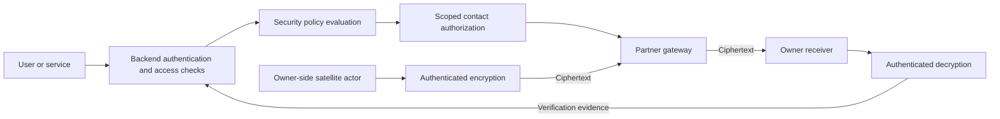

# Orbitron — Security Implementation Plan

**Upload location:** `security/plan.md`  
**Module:** Identity support, contact authorization and protected payload transfer  
**Plan version:** 1.0  
**Shared API contract:** `orbitron.v1`  
**Target:** Working security controls for the local Orbitron prototype.

---

## 1. Instructions to the implementing agent

You are implementing Orbitron’s security module.

The project must allow approved organisations to share ground-station capacity while retaining control over access and payload decryption.

Your implementation must provide actual authorization checks and authenticated encryption.

Unreadable placeholder text, fixed rejection responses and hardcoded successful verification do not satisfy this plan.

### Read before implementation

Read:

1. Repository-level instructions, including any `AGENTS.md`.
2. `frontend/plan.md`.
3. `backend/plan.md`.
4. `scheduler/plan.md`.
5. `simulation/plan.md`.
6. This complete document.

Preserve the interfaces already defined.

### Ownership

Implement application code inside `security/`.

The backend owns:

- HTTP routes.
- Users and sessions.
- Database records.
- Resource permissions.
- Operation coordination.
- Audit persistence.

The simulation module owns:

- Satellite actors.
- Gateway processes.
- Owner receiver processes.
- Actual payload transport.

You provide reusable policy, token and encryption functions.

Do not create competing authentication routes, a second database or a second payload-transfer service.

---

## 2. Security goals

Implement these concrete controls:

1. Requests are tied to authenticated users or services.
2. Access is limited to permitted organisations and resources.
3. Station sharing requires an approved relationship.
4. A contact authorization applies only to a specific contact and action.
5. Expired, revoked or mismatched permissions cannot authorize new execution.
6. Partner gateways receive encrypted payloads.
7. Payload decryption keys remain with the satellite owner.
8. Modified encrypted data fails verification.
9. Security decisions produce useful evidence.
10. Missing security capabilities do not cause access to be granted automatically.

### Prototype boundary

This is a software prototype using local processes and configured identities.

It does not demonstrate:

- Hardware-backed onboard key storage.
- Real agency onboarding.
- Production spacecraft integration.
- Full zero-trust certification.
- Protection against a privileged user controlling the entire development computer.

Describe the implemented controls accurately.

---

## 3. Architecture



### Separation of concerns

There are three different security mechanisms:

| Mechanism | Purpose |
|---|---|
| Browser/service authentication | Establish who is making an API request |
| Contact authorization | Permit a specific receiving/forwarding operation |
| Payload encryption | Protect content while it passes through a partner |

Do not use one token or key for all three purposes.

A scheduling decision does not automatically grant contact permission.

A contact permission does not provide a payload decryption key.

---

## 4. Technology choices

Use:

- Python compatible with the other modules.
- `cryptography` for AES-GCM and Ed25519 key operations.
- PyJWT with EdDSA support for signed contact tokens.
- An established Argon2id library if password helpers are needed.
- Standard-library secure random generation.
- Pytest.

Pin compatible versions.

Do not implement cryptographic primitives manually.

Do not use:

- Base64 as encryption.
- Reversible password storage.
- A shared gateway signing secret.
- JWT signature verification with unrestricted algorithms.
- Deterministic encryption nonces derived from the simulation seed.

---

## 5. Folder structure

Use a structure similar to:

```text
security/
├── plan.md
├── README.md
├── IMPLEMENTATION_REPORT.md
├── requirements.in
├── requirements.lock
├── __init__.py
├── api.py
├── contracts.py
├── exceptions.py
├── policy/
│   ├── contacts.py
│   └── scopes.py
├── tokens/
│   ├── issuer.py
│   ├── verifier.py
│   ├── claims.py
│   └── keys.py
├── payload/
│   ├── encryption.py
│   ├── envelopes.py
│   └── associated_data.py
├── identity/
│   └── passwords.py
├── testing/
│   ├── challenges.py
│   └── evidence.py
├── cli/
└── tests/
```

Store generated local issuer keys under an ignored directory:

```text
security/.runtime/
```

Do not commit keys, tokens or working payload files.

---

## 6. Required Python interfaces

Implement these functions in `security/api.py`.

### 6.1 Capability discovery

```python
def capabilities() -> dict:
    ...
```

### 6.2 Contact policy

```python
def evaluate_contact(context: dict) -> dict:
    ...
```

### 6.3 Contact-token issuance

```python
def issue_contact_token(
    context: dict,
    private_key: bytes,
) -> dict:
    ...
```

### 6.4 Contact-token verification

Preserve the signature required by the simulation plan:

```python
def verify_contact_token(
    token: str,
    public_key: bytes,
    expected_scope: dict,
    server_time: str,
    simulation_time: str,
) -> dict:
    ...
```

### 6.5 Payload encryption

```python
def encrypt_payload(
    plaintext: bytes,
    key: bytes,
    associated_data: bytes,
) -> dict:
    ...
```

### 6.6 Payload decryption

```python
def decrypt_payload(
    envelope: dict,
    key: bytes,
    associated_data: bytes,
) -> bytes:
    ...
```

### 6.7 Shared associated-data encoding

```python
def canonical_payload_aad(fields: dict) -> bytes:
    ...
```

### 6.8 Security-test preparation

```python
def build_security_challenge(
    test_case: str,
    context: dict,
    private_key: bytes,
) -> dict:
    ...
```

Keep these functions independent of backend persistence.

The backend constructs trusted contexts and persists results.

---

## 7. Capability reporting

Return a structure such as:

```json
{
  "contract_version": "orbitron.v1",
  "contact_authorization": true,
  "token_verification": true,
  "payload_encryption": true,
  "security_checks": true
}
```

Report `true` only for implemented, usable capabilities.

Do not return success from stub functions.

Capability availability does not prove:

- A station is connected.
- A receiver is running.
- A contact is currently executable.
- A security test passed.

The backend combines module availability with its runtime state.

---

## 8. Browser and service identity integration

The backend already owns authentication.

Preserve its existing behaviour.

### Browser sessions

Maintain compatibility with:

```text
orbitron_session
HttpOnly session cookie
SameSite=Lax
X-CSRF-Token
```

Local HTTP configuration may use `Secure=false`.

Do not replace the browser session contract with frontend-stored JWTs.

### Password storage

If providing password helpers:

- Use Argon2id.
- Preserve compatibility with already stored valid hashes.
- Use library-managed salts.
- Support verifying and upgrading hashes where needed.
- Do not silently downgrade parameters.

A suitable minimum starting configuration is:

```text
memory: 19 MiB
iterations: 2
parallelism: 1
```

Stronger compatible library defaults are acceptable if practical on the target machine.

Benchmark the chosen configuration.

### Service credentials

Service bearer credentials are separate from contact tokens.

The backend authenticates:

```text
simulator_controller
satellite
station_gateway
owner_receiver
```

Random high-entropy service tokens can be stored as hashes.

Do not use a fast hash as the password-storage mechanism.

Do not infer resource access merely because a bearer credential is valid.

### Service-generated jobs

Preserve the simulation plan’s use of:

```text
POST /jobs
```

with satellite service authentication and:

```text
Idempotency-Key
X-Orbitron-Scenario-ID
```

Browser requests retain their existing cookie/CSRF path.

Both authentication paths must reach the same backend job-creation validation.

---

## 9. Trusted policy context

`evaluate_contact()` receives a backend-constructed context.

Expected information includes:

```text
principal
satellite
station
antenna
job
contact
sharing_relationship
requested_action
scenario_id
authorization_id
simulation_time
server_time
```

Issuance also requires the intended gateway identity and applicable configuration.

### Trust boundary

The context must be assembled from authenticated identity and saved backend records.

Do not accept an HTTP body containing:

```text
authenticated = true
role = network_admin
partner_approved = true
```

and treat those assertions as authoritative.

The function assumes the backend adapter supplied trusted records, not arbitrary client claims.

### Required consistency checks

Verify:

- Contact belongs to the job.
- Job belongs to the satellite.
- Job owner matches the satellite owner.
- Antenna belongs to the station.
- Band is supported.
- Contact bounds are valid.
- Requested action is supported.
- Relevant resources are usable.
- Sharing is permitted.
- Contact has not been cancelled or failed.
- The scenario is current.

The backend remains responsible for independent scheduling and resource-conflict validation.

---

## 10. Sharing policy

For an owner’s own station:

- Permit consideration under normal resource and contact rules.

For a partner station, require:

1. Station sharing enabled.
2. Job owner listed as an approved partner.
3. Matching backend-approved sharing relationship.
4. Permitted receiving/forwarding action.
5. Compatible contact and equipment.
6. No applicable revocation or explicit denial.

A registered organisation is not automatically approved for every station.

A network administrator does not bypass sharing policy merely because the role is privileged.

### Supported action

For the initial prototype:

```text
receive_and_forward
```

Do not grant satellite-command rights.

Do not interpret this permission as permission to:

- Read plaintext.
- Obtain decryption keys.
- Change satellite configuration.
- Access unrelated jobs.
- Use a different antenna.
- Extend the contact window.

---

## 11. Policy result

Return:

```json
{
  "allowed": true,
  "reasons": [],
  "scope": {},
  "expires_at": "UTC timestamp"
}
```

On denial:

```text
allowed = false
reasons = actual reasons
scope = null
expires_at = null
```

### Scope fields

The permitted scope contains:

```text
scenario_id
authorization_id
satellite_id
station_id
antenna_id
contact_id
owner_org_id
allowed_action
contact_start_at
contact_end_at
schedule_version
```

`allowed_action` is:

```text
receive_and_forward
```

### Planning versus execution

Policy eligibility for a future contact does not mean transmission can begin immediately.

The token verifier separately enforces the executable simulation-time window.

Token issuance additionally requires the necessary backend confirmation state.

Do not let a positive planning-policy result become an unrestricted gateway credential.

---

## 12. Authorization lifecycle

The backend owns the saved authorization record.

Use the existing public statuses:

```text
pending
allowed
denied
expired
revoked
```

### Suggested lifecycle

1. Booking created: pending.
2. Station confirms booking.
3. Backend evaluates contact policy.
4. Backend issues an appropriately scoped token near execution.
5. Authorization becomes allowed.
6. Expiry, revocation or invalidation changes its status.

### Just-in-time issuance

Initially issue executable grants only when:

- Contact is confirmed or active.
- Gateway identity is valid.
- Policy permits it.
- Simulation time is within a configured pre-start issuance interval or inside the contact.
- Contact has not ended.

Use a documented initial pre-start interval, such as 60 simulation seconds.

Do not issue long-lived unrestricted permissions to compensate for distant future passes.

### Renewal

An expired token can be replaced only after fresh policy evaluation.

A gateway cannot extend a token by editing `exp`.

A renewed authorization receives a new authorization ID.

The backend updates the current authorization reference and revokes the replaced grant where appropriate.

---

## 13. Signed contact-token format

Use signed JWTs with:

```text
Algorithm: EdDSA using Ed25519
Issuer: orbitron-local
Audience: orbitron-payload-relay
Type header: orbitron-contact+jwt
```

Use a compatible pinned PyJWT implementation.

### Keys

- Backend issuer holds the signing private key.
- Gateways and receivers receive the trusted public verification key.
- Gateways never receive the signing private key.

Use PEM-encoded keys:

- Private key: PKCS#8.
- Public key: SubjectPublicKeyInfo.

Do not mix raw key bytes and PEM bytes without explicit conversion.

### Required claims

Include:

```text
iss
aud
sub
jti
iat
nbf
exp
contract_version
scope
```

Values:

```text
contract_version = orbitron.v1
sub = station:<station_id>
jti = authorization_id
```

`scope` contains the fields from Section 11.

### Key identifier

Use a deterministic identifier derived from the trusted public key.

For example, derive it from a SHA-256 fingerprint of its standard public-key encoding.

The verifier must resolve only configured trusted keys.

Do not follow token-supplied URLs or filesystem paths.

### Visibility

JWT claims are readable.

Do not place payload keys, passwords or confidential payload contents in token claims.

The signature authenticates claims; it does not encrypt them.

---

## 14. Token issuance

`issue_contact_token()` must:

1. Validate the trusted context.
2. Evaluate policy.
3. Verify contact confirmation and issuance timing.
4. Create a short-lived grant.
5. Sign with the issuer private key.
6. Return token, expiry and scope.

Return:

```text
token
expires_at
scope
```

The authorization ID is included in scope and `jti`.

### Wall-clock lifetime

Use a configurable initial lifetime:

```text
300 real-time seconds
```

Set a documented maximum, initially:

```text
600 real-time seconds
```

The token’s real-time lifetime is separate from its simulated contact window.

### Persistence

The backend stores:

- Authorization ID.
- Scope.
- Issue and expiry times.
- Status.
- Token hash.
- Relevant audit metadata.

If internal service-command delivery requires a serialized short-lived token, restrict that storage to internal records and remove it when no longer needed.

Never include it in public snapshots or logs.

### Transaction coordination

The backend must recheck current contact state before committing the authorization.

Do not issue a grant for a booking that was moved or cancelled during processing.

---

## 15. Token verification

`verify_contact_token()` returns:

```text
allowed
reasons
claims
```

On denial:

```text
allowed = false
claims = null
```

On success, `claims` contains verified claims only.

### Verification order

Verify:

1. Token is structurally valid and within size limits.
2. Header type is correct.
3. Algorithm is exactly the configured allowed algorithm.
4. Key identifier matches trusted configuration.
5. Signature is valid.
6. Issuer is correct.
7. Audience is correct.
8. Required claims exist with correct types.
9. Real-time validity is satisfied.
10. Scope matches the expected resources.
11. Current scenario matches.
12. Current authorization remains allowed.
13. Contact execution state is valid.
14. Simulation time is inside the contact interval.
15. Trusted context is fresh enough.

Do not obtain the accepted algorithm from the untrusted token header.

### Explicit real-time verification

The function receives `server_time` explicitly.

Tests and runtime code must use that supplied trusted timestamp consistently.

If PyJWT’s automatic temporal checks cannot use the supplied clock:

- Keep signature, issuer and audience verification enabled.
- Perform all required temporal checks explicitly after verified decoding.
- Do not accidentally disable time verification altogether.

For the initial same-host prototype, use zero configured clock leeway.

Enforce:

```text
nbf <= server_time < exp
iat <= server_time
exp > iat
exp - iat <= configured maximum lifetime
```

Validate numeric claim types. Reject Boolean values masquerading as integers.

### Simulation-time verification

Enforce:

```text
contact_start_at <= simulation_time < contact_end_at
```

A valid wall-clock token does not authorize transmission outside the simulated pass.

A paused simulation does not stop real-time token expiry.

---

## 16. Expected scope and live context

The verifier’s `expected_scope` must be constructed from trusted configuration and recent backend records.

It must not simply copy fields out of the token being verified.

### Required matching

Compare the signed scope against:

- Current scenario.
- Expected authorization ID.
- Contact ID.
- Satellite ID.
- Station ID.
- Antenna ID.
- Owner organisation.
- Allowed action.
- Contact bounds.
- Contact’s booking version.

### Booking version

Use the contact’s own version.

Do not invalidate an unchanged protected contact merely because an unrelated booking caused the global schedule version to increase.

Changed or replaced contacts require corresponding authorization reconciliation.

### Runtime context

Alongside the expected scope, provide trusted runtime information:

```text
authorization_status
contact_status
station_operational_status
antenna_status
context_observed_at
```

The gateway’s expected station ID comes from its own configuration.

The owner receiver’s expected owner organisation comes from its own configuration.

### Freshness

Use a documented initial maximum context age, such as:

```text
5 real-time seconds
```

The caller supplies current real UTC time when verifying.

Do not reuse an old fetched server timestamp as “current time”, because that would make a stale context appear fresh forever.

If fresh authorization state cannot be obtained, deny new execution.

### Revocation limitation

Signature verification alone does not provide fresh revocation knowledge.

Refresh backend state before starting a transfer and during longer forwarding operations.

The backend must also reject new invalid progress or receipts according to its operational policy.

Do not claim instantaneous revocation across disconnected processes.

---

## 17. Payload encryption interface

Implement:

```python
encrypt_payload(plaintext, key, associated_data)
```

Use AES-256-GCM through the established library.

### Requirements

- Key length: 32 bytes.
- Fresh nonce: 12 bytes from a cryptographically secure generator.
- Authenticated associated data.
- Library-generated authentication tag.
- No plaintext in the returned envelope.
- No key in the returned envelope.

Do not accept a predictable scenario seed as encryption randomness.

Do not expose a caller-controlled nonce parameter.

### Envelope

Return exactly:

```json
{
  "version": "orbitron.payload.v1",
  "algorithm": "AES-256-GCM",
  "nonce_b64": "base64-encoded nonce",
  "ciphertext_b64": "base64-encoded ciphertext including authentication tag"
}
```

The sample values above are descriptive placeholders.

### Limits

For the initial local prototype:

```text
Maximum plaintext: 1,048,576 bytes
Maximum associated data: 4,096 bytes
```

Validate lengths before expensive processing.

The default sample remains the 65,536-byte plaintext sample from the simulation plan.

### Retry behaviour

A retransmission can reuse the same already prepared encrypted envelope.

Do not re-encrypt changed plaintext under the same key and nonce.

The simulation actor persists one immutable prepared envelope per transfer.

---

## 18. Payload decryption interface

Implement:

```python
decrypt_payload(envelope, key, associated_data)
```

### Validation

Validate:

- Expected envelope version.
- Exact supported algorithm.
- Required fields.
- Strict base64 encoding.
- Nonce length.
- Ciphertext bounds.
- Key length.
- Associated-data bounds.

Reject unsupported algorithms or malformed envelopes.

Do not silently fall back to another cipher.

### Authentication failure

Use the library’s authenticated decryption.

On failed authentication:

- Raise a controlled `PayloadIntegrityError`.
- Return no plaintext.
- Do not save an unverified output file.
- Do not classify the payload as delivered.

Do not catch an integrity exception and return the input or an empty successful payload.

### Exceptions

Provide clear exception classes, such as:

```text
EnvelopeValidationError
PayloadIntegrityError
SecurityConfigurationError
```

Keep external messages safe and readable.

Do not expose key material or plaintext in exception text.

---

## 19. Associated-data encoding

Implement the shared function:

```python
canonical_payload_aad(fields)
```

Required fields:

```text
scenario_id
transfer_id
contact_id
satellite_id
station_id
owner_org_id
expected_plaintext_sha256
```

### Encoding

Use:

- UTF-8.
- Sorted keys.
- Compact JSON separators.
- Validated string values.
- No additional unrecognized fields.

Return bytes.

All sender and receiver code must call this helper.

Do not maintain slightly different encodings in separate modules.

### Verification

The receiver reconstructs expected metadata from trusted backend records and its configured identity.

It must not treat arbitrary request metadata as proof of ownership.

Associated data is authenticated but visible. Do not put secret keys in it.

---

## 20. Key lifecycle and provisioning

Keep these key categories separate:

| Key or credential | Owner |
|---|---|
| Browser session token | Backend session service |
| Service bearer credential | Assigned service principal |
| Contact signing private key | Backend issuer |
| Contact verification public key | Gateways and receivers |
| Payload encryption/decryption key | Satellite owner |

### Issuer keys

Provide a CLI command equivalent to:

```text
python -m security.cli.init_keys \
  --output-dir security/.runtime/issuer
```

Generate:

```text
private.pem
public.pem
```

Use restrictive local permissions where supported.

Do not overwrite existing keys without an explicit replacement option.

Do not regenerate issuer keys on every application startup.

### Owner payload keys

Provide a secure key-generation helper for simulation preparation.

The simulation module stores owner keys under owner-private runtime directories.

For the local demo, use separate randomly generated owner keys for each organisation and scenario generation.

Do not derive them from:

- Organisation names.
- Satellite IDs.
- Passwords.
- Scenario seeds.

### Trust provisioning

Gateways receive the trusted public key through explicit local configuration.

Do not trust an arbitrary key supplied by the token itself.

### Rotation

Document a deliberate rotation procedure.

Rotating issuer keys or owner payload keys must not silently make the application pretend old work remains executable.

The backend and simulator must reconcile affected grants and transfers.

---

## 21. Transfer integration

Follow the actual transport flow in `simulation/plan.md`.

### Satellite-side actor

- Holds the owner-provisioned payload key.
- Creates the sample.
- Computes expected plaintext hash.
- Creates canonical associated data.
- Calls `encrypt_payload()`.
- Sends ciphertext through the partner gateway.

### Gateway

- Holds its own backend service credential.
- Holds trusted verification public material.
- Verifies the scoped contact permission.
- Checks its configured station identity.
- Forwards ciphertext.
- Does not receive owner payload keys.

### Owner receiver

- Holds its own backend service credential.
- Holds the owner payload key.
- Checks intended owner and transfer identity.
- Calls `decrypt_payload()`.
- Compares recovered and expected plaintext hashes.
- Reports actual verification evidence.

### Completion after acceptance

Authorization must be checked before accepting or forwarding new bytes.

Verification of bytes already accepted while authorized may finish after the transmission interval ends.

This must not authorize additional bytes outside the interval.

The backend owns the bounded late-receipt policy.

Do not weaken token expiry checks merely to accommodate delayed receipts.

---

## 22. Controlled security checks

Support exactly the existing public test cases:

```text
expired_authorization
wrong_station
tampered_payload
```

`build_security_challenge()` prepares an isolated test description.

The backend coordinates execution.

The simulator exercises the actual gateway/receiver paths.

### Test prerequisites

Require:

- Administrator initiation.
- Appropriate contact context.
- Required local actors available.
- An isolated test transfer/authorization identity.
- No mutation of unrelated live grants.

If prerequisites are missing, report that the test could not run.

Do not return `passed: true`.

### Expired authorization

Prepare a validly signed test grant with an expiry in the past.

Keep the other required fields valid.

Exercise the real verifier and record expiry rejection.

Do not make the test pass merely because the signature is invalid.

### Wrong station

Prepare a valid station-A grant.

Present it to station B.

Station B must derive its expected identity from configuration and reject the mismatch.

Do not compare the token’s station ID against a second copy of the same token field.

### Tampered payload

- Create a valid encrypted isolated sample.
- Change a decoded ciphertext byte.
- Preserve valid envelope encoding.
- Present it through the controlled test path.
- Require authenticated decryption to fail.

Changing an envelope into invalid JSON only tests parsing.

A plaintext hash mismatch alone does not establish that AES-GCM authentication was exercised.

### Isolated authorization records

The backend may create test-only authorization records through its coordination services.

Do not directly write its database from this module.

Do not replace an active live contact’s current grant merely to run a negative test.

---

## 23. Security-check results

Distinguish execution from correctness.

### Test completed and expected rejection occurred

```text
SecurityCheck.status = completed
SecurityCheck.passed = true
```

### Test completed but a control failed

For example, a wrong station was accepted:

```text
SecurityCheck.status = completed
SecurityCheck.passed = false
```

Preserve the observed outcome.

Do not transform this into a passing result.

### Test could not execute

For example, receiver unavailable:

```text
SecurityCheck.status = failed
SecurityCheck.passed = null
```

Include the actual reason.

### Operation state

An operation can succeed in completing a test whose security result is `passed: false`.

The frontend already distinguishes these concepts.

Do not use operation success as the security proof.

---

## 24. Revocation and operational changes

Re-evaluate or revoke permissions when:

- Contact is cancelled.
- Contact moves to another station or antenna.
- Contact bounds materially change.
- Sharing approval is removed.
- Service identity is revoked.
- Scenario resets.
- A relevant resource becomes unusable.
- A grant is replaced.

### Reset

Old scenario tokens must fail against the new scenario context.

Do not rely only on wall-clock expiry.

### Gateway disconnection

A disconnected gateway must not continue receiving fresh execution approval from stale cached state.

### Active contact

The scheduler protects active bookings by default.

Security revocation and equipment failure are different operational events.

Do not treat active-contact protection as permission to ignore a revoked grant.

The backend applies the configured interruption policy and records the outcome.

---

## 25. Errors and audit integration

Use the established `Reason` model:

```text
code
message
resource_ids
```

Use existing codes where appropriate:

```text
AUTHORIZATION_DENIED
PARTNER_NOT_APPROVED
STATION_OFFLINE
```

Additional useful codes include:

```text
INVALID_TOKEN
INVALID_SIGNATURE
INVALID_ALGORITHM
TOKEN_EXPIRED
CONTACT_NOT_STARTED
CONTACT_ENDED
WRONG_STATION
SCOPE_MISMATCH
WRONG_SCENARIO
AUTHORIZATION_REVOKED
CONTEXT_STALE
INVALID_ENVELOPE
PAYLOAD_INTEGRITY_FAILED
SECURITY_UNAVAILABLE
```

The frontend supports string reason codes.

### Audit evidence

Return sufficient safe information for the backend to record:

- Who requested the action.
- Which contact/resource was involved.
- Decision.
- Reason.
- Authorization ID.
- Relevant clock basis.

Never return:

- Private keys.
- Passwords.
- Raw session tokens.
- Owner plaintext.
- Full secret-bearing request bodies.

Token expiry uses server time.

Contact-window decisions use simulation time.

Preserve that distinction in recorded explanations.

---

## 26. Implementation order

### Stage A: policy and cryptographic helpers

1. Contracts and exceptions.
2. Capability reporting.
3. Trusted context validation.
4. Sharing-policy evaluation.
5. Ed25519 key utilities.
6. Token issuance.
7. Token verification.
8. AES-GCM envelope helpers.
9. Canonical associated data.

### Stage B: backend integration

1. Connect the backend security adapter.
2. Preserve existing session/password behaviour.
3. Bind service identities to resource scope.
4. Persist contact grants.
5. Expose grants only through scoped service work.
6. Add revocation/renewal coordination.
7. Verify unavailable-state handling.

### Stage C: simulation integration

1. Provision issuer public trust.
2. Provision owner payload keys.
3. Integrate satellite encryption.
4. Integrate gateway verification.
5. Integrate owner decryption.
6. Validate evidence and receipts.

### Stage D: negative checks and final verification

1. Expired grant.
2. Wrong station.
3. Modified ciphertext.
4. Reset invalidation.
5. Stale-context rejection.
6. Cross-organisation access tests.
7. Full frontend walkthrough.

Do not postpone real authorization enforcement until after the demonstration is otherwise complete.

---

## 27. Verification requirements

### Policy tests

Verify:

- Own-station request permitted when valid.
- Approved partner permitted when valid.
- Unapproved partner denied.
- Sharing-disabled station denied.
- Wrong satellite/job relationship denied.
- Wrong antenna/station relationship denied.
- Unsupported action denied.
- Cancelled/failed contact denied.
- Unusable resource denied.
- Privileged role does not bypass ownership/sharing rules.

### Token tests

Verify:

- Valid token accepted.
- Modified signature rejected.
- Wrong algorithm rejected.
- Wrong issuer rejected.
- Wrong audience rejected.
- Wrong header type rejected.
- Missing required claim rejected.
- Expired token rejected.
- Not-yet-valid token rejected.
- Excessive lifetime rejected.
- Wrong scenario rejected.
- Wrong authorization ID rejected.
- Wrong station rejected.
- Wrong antenna rejected.
- Wrong owner rejected.
- Changed contact bounds rejected.
- Revoked grant rejected.
- Stale context rejected.
- Token outside simulation contact interval rejected.
- Unrelated global schedule change does not invalidate an unchanged protected contact.

### Payload tests

Verify:

- Encryption/decryption round trip.
- Required 32-byte key validation.
- Nonce generated securely.
- No fixed nonce from scenario seed.
- Malformed base64 rejected.
- Unsupported envelope rejected.
- Changed ciphertext fails authentication.
- Changed associated data fails authentication.
- Wrong key fails authentication.
- Truncated authentication tag fails.
- Failed authentication returns no plaintext.
- Key/plaintext absent from envelope.
- Ciphertext length and sample limits enforced.

### Integration tests

Verify:

- Gateway receives no owner payload key.
- Browser receives no payload/signing key.
- Gateway cannot submit an owner receipt.
- Operator cannot create another owner’s job.
- Old scenario grant fails after reset.
- Expiry continues during simulation pause.
- Missing security module blocks protected execution.
- Security-check result reflects actual observed behaviour.

Use ephemeral test keys and isolated records.

Do not run destructive tests against the working demonstration state.

---

## 28. Local commands and configuration

From the repository root, provide:

```text
python -m pip install -r security/requirements.lock
python -m pytest security/tests -q
```

Provide issuer-key initialization:

```text
python -m security.cli.init_keys \
  --output-dir security/.runtime/issuer
```

Provide a self-check command that:

- Uses ephemeral keys.
- Exercises signature verification.
- Exercises encryption/decryption.
- Prints only non-secret results.
- Does not claim backend integration is complete.

### Configuration handover

Document settings needed by other owners, including:

```text
Authorization private-key path
Authorization public-key path
Issuer
Audience
Token lifetime
Maximum token lifetime
Context freshness limit
Payload size limit
```

Document how relative paths are resolved.

Do not hardcode a developer’s absolute filesystem path.

The documentation owner will include these settings in the final local setup workflow.

---

## 29. Deliverables and handover

Provide:

1. Contact policy implementation.
2. Signed-token issuance.
3. Strict token verification.
4. AES-GCM encryption/decryption helpers.
5. Canonical associated-data helper.
6. Issuer-key CLI.
7. Security-check preparation.
8. Backend and simulation adapter guidance.
9. Pinned dependencies.
10. Automated tests.
11. README.
12. `IMPLEMENTATION_REPORT.md`.

The report must state:

```text
Implemented Python interfaces:
Authentication compatibility:
Policy rules:
Token format and algorithms:
Clock and expiry rules:
Revocation behaviour:
Payload envelope:
Key provisioning:
Checks run and actual results:
Backend integration verified:
Gateway/receiver integration verified:
Negative scenarios verified:
Known limitations:
Exact local commands:
```

### Completion checklist

- [ ] Existing public API contract preserved.
- [ ] No competing authentication system.
- [ ] Sharing policy enforced.
- [ ] Contact permissions narrowly scoped.
- [ ] Signing private key absent from gateways.
- [ ] Token algorithm explicitly allowlisted.
- [ ] Signature, issuer and audience verified.
- [ ] Real-time expiry enforced.
- [ ] Simulation-time window enforced.
- [ ] Fresh context required.
- [ ] Revocation and reset handled.
- [ ] AES-256-GCM actually used.
- [ ] Nonces generated securely.
- [ ] Associated data encoded consistently.
- [ ] Failed integrity returns no plaintext.
- [ ] Partner gateway not provisioned payload keys.
- [ ] Owner receipt determines transfer verification.
- [ ] Negative tests exercise actual controls.
- [ ] Secrets excluded from frontend and logs.
- [ ] Other modules and plan files remain unchanged.

---

## 30. Out of scope

Do not add:

- Production agency identity federation.
- Real onboard hardware integration.
- Satellite-command authorization.
- A new identity provider.
- Blockchain.
- Production certification claims.
- A custom cipher.
- A custom signature algorithm.
- Shared signing secrets distributed to gateways.
- Fixed successful security-test responses.
- Claims that encryption prevents a partner from dropping data.
- Claims that encryption hides all traffic metadata.
- Claims of instantaneous revocation during disconnection.

---

## 31. Implementation references

Use primary documentation:

- [NIST zero-trust architecture](https://csrc.nist.gov/pubs/sp/800/207/final)
- [PyJWT usage and EdDSA support](https://pyjwt.readthedocs.io/en/latest/usage.html)
- [Cryptography authenticated encryption](https://cryptography.io/en/stable/hazmat/primitives/aead/)
- [OWASP password storage](https://cheatsheetseries.owasp.org/cheatsheets/Password_Storage_Cheat_Sheet.html)
- [OWASP session management](https://cheatsheetseries.owasp.org/cheatsheets/Session_Management_Cheat_Sheet.html)
- [OWASP CSRF prevention](https://cheatsheetseries.owasp.org/cheatsheets/Cross-Site_Request_Forgery_Prevention_Cheat_Sheet.html)

The Orbitron security interfaces must match the backend and simulation plans. Missing dependencies must be reported explicitly rather than bypassed.
