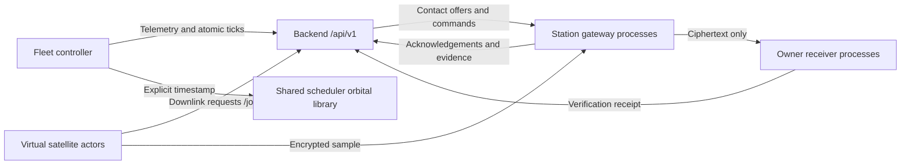

# Orbitron — Simulation Module

Virtual satellites, ground station gateways, protected payload transport, and scenario replay.

## Architecture Overview

The simulation module runs as an external operational participant for Orbitron, producing operational records through authenticated backend ingestion APIs and modeling actual spacecraft and ground station communications.



### Module Responsibilities

1. **Virtual Satellite Actors:**
   - Onboard monotonic data generation with subsecond fractional credit tracking.
   - Downlink request generation evaluating unreserved backlog against configured thresholds.
   - Owner-side authenticated encryption of demonstration payload samples using AES-256-GCM.
2. **Station Gateway Processes:**
   - Dedicated local gateway processes (`POST /relay/{transfer_id}`).
   - Scoped contact authorization validation using Ed25519 tokens.
   - Strict separation of concerns: Gateways handle and buffer ciphertext only and are **never** provisioned owner payload decryption keys.
   - Contact offer validation and station heartbeats.
3. **Owner Receiver Processes:**
   - Dedicated local receiver endpoints (`POST /receive/{transfer_id}`).
   - Authenticated decryption using owner payload keys and canonical JSON Associated Data (AAD).
   - Plaintext SHA-256 integrity verification. Verified payloads are saved only after successful verification.
   - Delivery receipt evidence submission to backend.
4. **Fleet Controller & Simulation Loop:**
   - Authoritative simulation clock synchronization with wall-clock pacing.
   - Bounded ticks (up to 60s per step) with runaway catch-up prevention.
   - Dynamic satellite propagation using the shared orbital library (`scheduler.api.propagate_satellites`).
   - Atomic simulation ticks submitted to `POST /ingest/ticks`.
   - Local checkpointing and reconciliation with backend state.
5. **Scenario Replay & Evaluation:**
   - Pure, isolated offline replay (`replay_scenario(scenario, algorithm)`) for `fifo` and `optimized` scheduling.
   - Exact computation of public `SchedulerMetrics` from simulated delivery events.
   - Support for disruption traces (rain capacity reduction, station outages, recovery, emergency job arrivals).

---

## Directory Structure

```text
simulation/
├── plan.md                       # Implementation specification (preserved)
├── README.md                     # Architecture and usage guide
├── IMPLEMENTATION_REPORT.md      # Detailed verification and integration report
├── requirements.in               # Direct dependency declarations
├── requirements.lock             # Pinned reproducible dependencies
├── __init__.py                   # Package exports
├── api.py                        # Public Python interface
├── config.py                     # Configuration and path loader
├── contracts.py                  # Pydantic models for orbitron.v1
├── exceptions.py                 # Custom exception hierarchy
├── orbital_adapter.py            # Adapter for scheduler.api.propagate_satellites
├── security_adapter.py           # Adapter for security.api cryptographic primitives
├── actors/
│   ├── satellite.py              # Virtual satellite actor
│   ├── station.py                # Station gateway actor
│   └── owner.py                  # Owner receiver actor
├── controller/
│   ├── clock.py                  # Simulation clock manager
│   ├── checkpoints.py            # Local checkpoint manager
│   ├── commands.py               # Command dispatcher
│   └── loop.py                   # Fleet controller loop
├── model/
│   ├── generation.py             # Data generation model
│   ├── progress.py               # Contact progress and fractional accounting
│   └── faults.py                 # Outage and disruption tracking
├── transport/
│   ├── backend_client.py         # HTTPX backend client with retries
│   ├── gateway_server.py         # FastAPI station gateway relay
│   ├── receiver_server.py        # FastAPI owner receiver endpoint
│   └── envelopes.py              # Cryptographic envelope helpers
├── replay/
│   ├── engine.py                 # Offline scenario replay engine
│   ├── events.py                 # Scenario event timeline queue
│   └── metrics.py                # SchedulerMetrics computation
├── fixtures/
│   └── scenarios/                # Standard, scale, and disruption scenario definitions
│       ├── default.json          # 10 satellites, 3 stations, 2 organisations
│       ├── scale.json            # 120 satellites, 12 stations
│       └── suite.py              # Scenario generators for all 16 profiles
├── cli/
│   ├── prepare.py                # Setup runtime directories and keys
│   └── run.py                    # Process supervisor
└── tests/                        # Comprehensive test suite
```

---

## Installation

Ensure Python 3.11+ is installed.

```bash
python -m pip install -r simulation/requirements.lock
```

---

## Usage

### 1. Prepare Runtime Environment
Prepares local directories under `simulation/.runtime/`, generates organization payload keys, and sets up demonstration sample payloads:

```bash
python -m simulation.cli.prepare \
  --backend-url http://localhost:8000/api/v1 \
  --credentials-file backend/.runtime/service-credentials.json
```

### 2. Run Supervised Simulation
Supervises gateway servers, owner receiver endpoints, and the fleet controller loop:

```bash
python -m simulation.cli.run \
  --backend-url http://localhost:8000/api/v1 \
  --credentials-file backend/.runtime/service-credentials.json
```

For standalone execution without a running backend:
```bash
python -m simulation.cli.run --standalone
```

---

## Running Automated Tests

Run the full test suite with pytest:

```bash
python -m pytest simulation/tests -v
```
