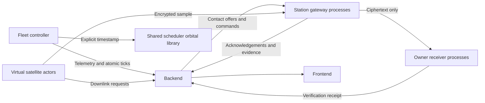

# Orbitron — Simulation Implementation Plan

**Upload location:** `simulation/plan.md`  
**Module:** Virtual satellites, ground stations, payload transport and scenario replay  
**Plan version:** 1.0  
**Shared API contract:** `orbitron.v1`  
**Target:** An independently running local simulation that produces operational records through the backend’s APIs.

---

## 1. Instructions to the implementing agent

You are implementing Orbitron’s simulation environment.

The simulator must behave like an external satellite and ground-station network.

It must not be a collection of predetermined successful demonstrations.

### Read before implementation

Read:

1. Repository-level instructions, including any `AGENTS.md`.
2. `frontend/plan.md`.
3. `backend/plan.md`.
4. `scheduler/plan.md`.
5. This complete document.
6. The security plan when available.

Use the same identifiers, units, timestamps, statuses and interfaces defined in those plans.

### Responsibilities

Implement:

- Virtual satellite actors.
- Satellite movement using the shared orbital library.
- Onboard data generation.
- Downlink-request generation.
- Virtual station gateways.
- Contact acknowledgement.
- Simulated contact progress.
- Owner receiver processes.
- Actual encrypted sample-file forwarding.
- Pause, resume, step and reset behaviour.
- Repeatable scenarios.
- Isolated scenario replay for evaluation.
- Local process management and verification.

### Boundaries

Work inside `simulation/`.

Do not:

- Edit the backend database.
- Implement a second scheduler.
- Implement a second orbital model.
- Reimplement cryptographic primitives.
- Invent frontend records.
- Mark backend jobs completed directly.
- Change other agents’ files or plans.

If a required interface is unavailable, document the dependency and coordinate with its owner.

Do not substitute a fake successful response.

---

## 2. What this module must prove

The simulator must demonstrate that Orbitron responds to changing operational inputs.

A satellite must have:

- A persistent identity.
- An owner.
- Orbital information.
- Communication capabilities.
- A changing position.
- Generated onboard data.
- A reported operational state.
- Requests for data delivery.

A station must have:

- A persistent identity.
- An owner.
- Antenna resources.
- Communication capabilities.
- Operational availability.
- Gateway connectivity.
- Assigned contacts.
- The ability to accept or reject work.

The backend must receive these inputs, validate them and save the resulting records.

### Required distinction

The system contains two different demonstrations:

1. **Mission-data simulation:** models movement, capacity and delivery counters.
2. **Encrypted sample transfer:** actually encrypts and forwards a small file between local processes.

Do not claim that forwarding a small sample physically transferred an entire gigabyte-scale simulated job.

---

## 3. Architecture and ownership



### Authoritative state

The backend owns:

- Current scenario.
- Simulation clock.
- Saved satellite and station records.
- Jobs.
- Bookings.
- Authorizations.
- Accepted progress.
- Operations.
- Delivery results.

The simulator owns:

- Virtual actor behaviour.
- Candidate observations.
- Pending outbound messages.
- Owner-side sample files.
- Local transport processes.

The simulator advances its committed local state only after backend acceptance.

---

## 4. Virtual actors and local processes

Use these roles:

| Role | Responsibility |
|---|---|
| Fleet controller | Coordinates simulation ticks and virtual satellite actors |
| Satellite actor | Generates data, requests downlinks and prepares owner-protected samples |
| Station gateway | Confirms bookings and forwards encrypted samples |
| Owner receiver | Decrypts and verifies its organisation’s samples |
| Replay engine | Evaluates frozen scenarios without changing the live application |

### Process model

For the initial prototype:

- One controller process can host many logical satellite actors.
- Run station gateways as separate processes.
- Run owner receivers as separate processes.
- Provide one command that starts and supervises these processes.

Do not launch 120 operating-system processes merely because the scenario contains 120 satellites.

### Default scenario

Start with:

```text
10 satellites
3 stations
2 organisations
```

Then support a scale scenario with:

```text
120 satellites
up to 12 stations
```

Do not change dataset size only in the frontend.

---

## 5. Technology and folder structure

Use:

- Python compatible with the other Python modules.
- HTTPX for backend and peer HTTP communication.
- FastAPI/Uvicorn for local gateway and receiver endpoints.
- Asyncio or another simple bounded concurrency approach.
- The scheduler’s orbital functions.
- The security module’s encryption and verification functions.
- Pytest.

Use compatible pinned dependencies.

Suggested structure:

```text
simulation/
├── plan.md
├── README.md
├── IMPLEMENTATION_REPORT.md
├── requirements.in
├── requirements.lock
├── __init__.py
├── api.py
├── config.py
├── contracts.py
├── controller/
│   ├── loop.py
│   ├── clock.py
│   ├── checkpoints.py
│   └── commands.py
├── actors/
│   ├── satellite.py
│   ├── station.py
│   └── owner.py
├── transport/
│   ├── backend_client.py
│   ├── gateway_server.py
│   ├── receiver_server.py
│   └── envelopes.py
├── model/
│   ├── generation.py
│   ├── progress.py
│   └── faults.py
├── replay/
│   ├── engine.py
│   ├── events.py
│   └── metrics.py
├── cli/
│   ├── prepare.py
│   └── run.py
├── fixtures/
│   └── scenarios/
└── tests/
```

Store local files under an ignored directory:

```text
simulation/.runtime/
```

Do not commit credentials, keys, working payloads or checkpoints containing sensitive configuration.

---

## 6. Shared backend interface

Use the backend API prefix:

```text
http://localhost:8000/api/v1
```

Use the service interfaces established in `backend/plan.md`:

```text
POST /ingest/catalog
POST /ingest/telemetry
POST /ingest/station-heartbeats
POST /ingest/contact-progress
POST /ingest/ticks

GET  /service/work
POST /service/commands/{command_id}/ack

POST /ingest/transfer-progress
POST /ingest/delivery-receipts
```

Satellite-generated jobs use:

```text
POST /jobs
```

with the same job body used by the frontend.

### Service authentication for job creation

The backend must support a satellite service principal creating a job for a satellite within its scope.

For this service-authenticated request:

- Send a bearer credential.
- Send `Idempotency-Key`.
- Send `X-Orbitron-Scenario-ID`.
- Use the unchanged public job body.
- Derive ownership from the authenticated service principal.
- Do not supply an arbitrary owner organisation.

Browser job creation continues using session cookies and CSRF.

This is an additional authentication path for the existing endpoint, not a second job implementation.

The backend owner must connect both paths to the same job-creation service.

### Connectivity

The controller continues polling `/service/work` while paused.

The backend records authenticated controller activity for simulator connectivity.

Stations additionally use their explicit heartbeat endpoint.

Do not stop all communication when simulation time is paused.

---

## 7. Service credentials and resource scope

Use separate service identities for:

```text
simulator_controller
satellite
station_gateway
owner_receiver
```

A controller can have explicit delegated access to its local simulation namespace.

Each gateway and receiver must retain its own identity.

### Credential handling

- Read credentials from local ignored configuration.
- Send them through HTTP authorization headers.
- Never place token values in command-line arguments.
- Never print token values.
- Never commit credential files.
- Never put service credentials into the frontend.
- Do not forward a backend service credential to a peer payload endpoint.

Peer payload requests use the scoped contact authorization supplied for that transfer.

### Process separation

A gateway process must not receive:

- Owner payload keys.
- Owner receiver credentials.
- Other stations’ credentials.
- The backend’s authorization signing private key.

Pass an explicit minimal environment to each child process.

Do not give every process the parent’s complete secret-bearing environment.

This is a local demonstration of role separation. Do not claim that processes sharing one developer computer provide hardware-enforced isolation.

---

## 8. Service work and command contract

The backend service-work endpoint needs a consistent private response.

Use the following structure, filtered to the authenticated principal:

```text
contract_version
scenario_id
server_time
simulation_time
principal
simulator
scenario
catalog
jobs
assignments
commands
checkpoints
simulation_config
```

### Principal

```text
id
role
permitted_resource_ids
```

### Catalogue

```text
organizations
satellites
stations
orbit_definitions
```

Use the existing public record shapes and scheduler orbital-definition shape.

### Assignment

Each assignment contains:

```text
contact
authorization
```

`contact` matches the public `Contact` model.

`authorization` is either `null` or contains:

```text
token
expires_at
scope
```

Treat the token as opaque. Its encoding is owned by the security module.

Do not expose these private authorization tokens through the public snapshot.

### Command

Each command contains:

```text
id
operation_id
scenario_id
kind
resource_id
payload
created_at
expires_at
```

Required command kinds:

```text
initialize_scenario
pause
resume
step
reset
contact_offer
prepare_transfer
security_check
```

These are private service-command kinds. They do not replace the public operation-kind enum.

### Checkpoints

Provide the relevant accepted state:

```text
last_tick_event_id
last_tick_sequence
last_tick_simulation_time
satellite_generation_counters
resource_event_sequences
```

The backend owner must provide these values from saved ingestion state.

### Simulation configuration

Provide:

- Tick size.
- Satellite generation profiles.
- Automatic request policies.
- Station gateway addresses.
- Owner receiver addresses.
- Relevant scenario parameters.

Do not independently load a conflicting catalogue just because a local fixture exists.

If this private packet is not yet implemented, report the exact integration dependency.

---

## 9. Common event and retry rules

Service events use the agreed fields:

```text
event_id
scenario_id
sequence
observed_at
```

Resource-specific event fields follow the backend plan.

### Event identity

Generate a stable event ID before transmission.

For a retry:

- Preserve event ID.
- Preserve sequence.
- Preserve payload.
- Preserve scenario ID.

Do not generate a new event ID for every network retry.

### Accepted state

Advance local committed counters only after:

- An accepted response.
- A duplicate response confirming previous acceptance.
- Reconciliation against backend checkpoints.

### Uncertain response

If a request times out:

1. Preserve the pending event.
2. Retry the identical request within a bounded retry policy.
3. If needed, retrieve backend work/checkpoints.
4. Reconcile before generating later dependent events.

Do not assume timeout means rejection.

### Definite rejection

If the backend definitively rejects a tick because current conditions changed:

1. Refresh authoritative state.
2. Confirm that the rejected event was not accepted.
3. Recompute the candidate tick.
4. Use a new event ID for the changed payload.
5. Preserve monotonic committed sequences.

### Backoff

Use bounded exponential backoff for transient network errors.

Do not retry indefinitely at full speed.

Do not automatically retry permission failures or malformed requests as if they were temporary connectivity issues.

---

## 10. Simulation clock and controller loop

The backend’s simulation clock is authoritative.

Use a monotonic wall-clock source only to pace the local loop.

### Initial defaults

Suggested defaults:

```text
simulation tick: 1 second
speed multiplier: 1
```

A faster demonstration configuration is allowed, but must be reported in the UI through backend state.

### Tick procedure

For each candidate tick:

1. Fetch or use sufficiently recent authoritative work.
2. Process pending control commands.
3. Confirm the scenario ID.
4. Read the current backend simulation time.
5. Choose the next bounded simulation timestamp.
6. Calculate satellite positions at that timestamp.
7. Calculate generated-data counters.
8. Calculate contact progress over the interval.
9. Assemble one atomic tick.
10. Persist the pending message locally.
11. Send it to the backend.
12. Commit the local checkpoint after acceptance.

### Atomic tick body

Use:

```text
event_id
scenario_id
previous_simulation_time
simulation_time
telemetry[]
station_heartbeats[]
contact_progress[]
```

Each nested record follows the corresponding ingestion schema.

Generate nested event IDs deterministically from the parent tick ID and resource, so retries remain identical.

### Limits

- A tick must advance time positively.
- Never exceed 60 simulation seconds in one accepted tick.
- Use smaller ticks when approaching meaningful boundaries.
- Do not jump over known faults, contact boundaries or scheduled scenario actions without integrating them correctly.

### No runaway catch-up

If the computer stalls, do not send a huge unbounded time jump.

Use bounded catch-up or explicitly slow the achieved simulation speed.

Report lag in local diagnostics.

---

## 11. Satellite movement

Call:

```python
scheduler.api.propagate_satellites(
    orbit_definitions,
    at=target_simulation_timestamp,
)
```

Use the returned positions.

Do not:

- Create a second propagation model.
- Move satellites using arbitrary screen coordinates.
- Use random latitude/longitude updates.
- Replace invalid propagation with zero coordinates.
- Advance orbital movement using browser time.

### Provenance

Preserve:

```text
source = simulated
orbit_source = public_tle | synthetic
```

A synthetic orbit must be identified as synthetic.

The normal scenario must work with packaged orbital data and an aligned simulation epoch.

If orbital data is invalid or outside the configured policy:

- Stop affected movement reporting.
- Report a clear error.
- Preserve the last accepted backend observation.
- Do not fabricate continued motion.

---

## 12. Onboard data generation

Each satellite profile specifies an integer generation rate:

```text
generation_rate_bytes_per_second
```

It may also specify an initial backlog through scenario registration.

### Generation counter

Maintain:

```text
generated_bytes_total
```

as a monotonic counter within the scenario.

For a time interval:

```text
new generation =
  configured generation rate × elapsed simulation time
```

Preserve fractional credit if subsecond calculations are used.

Do not reset the counter merely because a downlink succeeded.

The backend combines:

- Initial onboard data.
- Accepted generated-data increments.
- Accepted delivery increments.

### No double accounting

Do not:

1. Reduce satellite backlog locally.
2. Report a lower backlog.
3. Also report contact delivery that reduces it again.

Send generation counters and contact progress through their agreed independent fields.

The backend owns the resulting `onboard_bytes`.

### Faults

A profile can define whether data generation continues during a satellite communication fault.

Document the rule.

Do not assume a communication fault necessarily means every onboard instrument stops generating data.

---

## 13. Automatic downlink requests

Satellite actors can submit requests based on their profiles.

A profile may define:

```text
automatic_requests_enabled
request_threshold_bytes
maximum_request_bytes
deadline_offset_seconds
priority
allow_split
```

### Request procedure

1. Read the latest permitted backend satellite and job records.
2. Estimate unreserved backlog.
3. If the threshold is met, construct a request.
4. Submit through `/jobs`.
5. Preserve the idempotency key until the result is known.
6. Store the returned job ID.

### Unreserved backlog

For the satellite:

```text
unreserved backlog =
  onboard bytes
  - remaining bytes reserved by non-cancelled jobs
```

The backend remains authoritative and may reject a stale estimate.

Do not repeatedly submit the same backlog under new IDs.

### Emergency jobs

An emergency is an actual job with:

```text
priority = emergency
```

It must go through the same ownership, validation and persistence path.

Do not directly create an emergency booking or mark it delivered.

### Repeatability

Use deterministic workload-generation decisions where appropriate.

Randomness can determine workload characteristics, but it must not determine whether scheduling, authorization or decryption succeeds.

---

## 14. Station gateways and acknowledgements

A gateway process represents one registered station.

It polls its scoped work and sends station heartbeats.

### Contact offer

On `contact_offer`:

1. Verify the command is addressed to this station.
2. Verify scenario ID.
3. Verify the contact and schedule version.
4. Check station and antenna capabilities.
5. Check local operational availability.
6. Accept or reject with a real reason.
7. Acknowledge the command using the gateway’s credential.

Do not acknowledge every contact automatically without checking it.

### Confirmation is not authorization

A gateway confirming a booking does not grant payload access or permission to execute.

Execution also requires allowed authorization and the correct contact interval.

### Local station state

Reflect backend-controlled outage and recovery state.

A heartbeat must not accidentally restore an administrator-triggered outage.

The backend must preserve any active outage override until recovery is applied.

The gateway should read and follow that state rather than continuously reporting “online” from a fixed default.

### Connectivity

A gateway can be:

- Connected and operational.
- Connected but unavailable.
- Stale.
- Disconnected.

Do not collapse these states into one Boolean.

---

## 15. Simulated contact progress

Contact progress models mission-data delivery.

It must follow actual accepted bookings.

### Required conditions

Transmit only when:

- The contact is confirmed or active.
- Its authorization is allowed.
- The station and antenna are usable.
- The satellite is available for downlink.
- The simulated interval intersects the contact.
- Satellite resource limits permit execution.
- The job still has remaining allocated work.

Do not transmit during antenna setup.

### Effective rate

Use the configured physical model consistently with scheduling.

The instantaneous model rate must not exceed:

- Satellite capability.
- Antenna capability.
- Current station capacity.
- The contact’s booked expected rate.

Apply weather exactly once.

### Interval calculation

For a tick:

```text
eligible start = max(tick start, contact start)
eligible end   = min(tick end, contact end)
```

If end is not later than start, transfer zero bytes.

Split integration at relevant state-change boundaries.

### Cumulative progress

Report:

```text
cumulative_transferred_bytes
```

for the contact.

Bound it by:

- Contact allocation.
- Remaining job data.
- Integrated capacity.

### Fractional capacity

Preserve fractional byte credit across ticks.

For integer-microsecond calculations, one possible representation is:

```text
credit += rate_bps × elapsed_microseconds
new_bytes = credit // 8,000,000
credit = credit % 8,000,000
```

The backend must validate cumulative capacity consistently, including previously accumulated fractional credit.

Do not round every small tick upward.

### Completion

Send the final report when the allocation is completed or the contact ends.

If less than allocated data transfers:

- Report the actual counter.
- Report final state honestly.
- Let the backend decide the contact/job status.
- Let recovery scheduling handle remaining data.

The simulator must not replace a missed contact with an invented successful delivery.

---

## 16. Rain, outages and changing conditions

The live demonstration primarily receives disruption actions through the frontend/backend.

The simulator observes and follows the resulting authoritative state.

### Rain

When the backend applies a lower capacity factor:

- Reduce modeled transfer capacity.
- Preserve already transferred bytes.
- Use updated conditions for subsequent intervals.
- Do not force a particular replacement booking.

### Outage

When a station becomes unavailable:

- Stop new execution.
- Stop affected simulated transmission according to the operational boundary.
- Reject new incompatible work.
- Preserve already accepted progress.
- Continue appropriate process heartbeats if the gateway itself is still running.

### Gateway crash

If a gateway process crashes:

- Its heartbeats stop.
- The backend detects stale/disconnected state.
- The controller must not continue reporting successful station activity on its behalf.

### Recovery

On recovery:

- Resume availability only after the corresponding state change.
- Let the backend/scheduler decide whether to use the resource.

No scenario may contain instructions such as “move job X to station Y and mark success”. Scenarios specify conditions and requests, not scheduler outcomes.

---

## 17. Pause, resume, step and reset

These commands originate through the backend.

### Pause

On `pause`:

1. Finish or reconcile the in-flight tick.
2. Stop initiating advancing ticks.
3. Stop new simulated transmission intervals.
4. Stop initiating new sample-transfer chunks.
5. Continue work polling and connectivity activity.
6. Acknowledge only after the pause is effective.

In-flight acknowledgements may still arrive.

Wall-clock session and credential expiry continue.

### Resume

On `resume`:

1. Verify the current scenario.
2. Acknowledge readiness through the backend.
3. Resume advancement from the accepted backend timestamp.
4. Do not count paused wall time as operational time.

### Step

On a paused 60-second step:

- Advance exactly 60 simulation seconds.
- Use smaller internal ticks when needed.
- Process boundaries and actor behaviour normally.
- Remain paused after completion.
- Acknowledge with the completed simulation timestamp.

The backend must authorize the bounded stepping interval while ordinary advancement remains paused.

Do not temporarily switch to unrestricted running and hope to stop at the right time.

### Reset

Reset is a coordinated generation change.

Use this sequence:

1. Backend issues reset for the old scenario.
2. Controller stops ticks and payload activity.
3. Controller acknowledges that old activity is quiesced.
4. Backend creates the new scenario generation.
5. Backend exposes an `initialize_scenario` command.
6. Controller loads the new catalogue and accepted counters.
7. Gateways and receivers discard old assignments.
8. Controller acknowledges new-scenario readiness.
9. Backend completes the reset operation.

Reset must not be marked complete merely because a process cleared its local memory.

Late events from the old scenario must be rejected.

---

## 18. Actual encrypted sample transfer

This part transfers real bytes between local processes.

### Data path

```text
Owner-side satellite actor encrypts sample
→ partner gateway receives ciphertext
→ partner gateway forwards ciphertext
→ owner receiver decrypts and verifies
→ owner receiver reports evidence to backend
```

### Sample size

Default to a small sample, such as:

```text
65,536 plaintext bytes
```

Make the size configurable within a documented safe local limit.

The sample contains synthetic demonstration content.

### Ownership

The satellite-side actor and owner receiver are provisioned with the owner’s payload key.

The partner gateway is not provisioned that key.

Do not send the key:

- Through the backend snapshot.
- In a contact authorization.
- In payload metadata.
- To the gateway.
- To the frontend.

### Security-module interfaces

Reserve these functions for the security plan:

```python
def encrypt_payload(
    plaintext: bytes,
    key: bytes,
    associated_data: bytes,
) -> dict:
    ...
```

```python
def decrypt_payload(
    envelope: dict,
    key: bytes,
    associated_data: bytes,
) -> bytes:
    ...
```

```python
def verify_contact_token(
    token: str,
    public_key: bytes,
    expected_scope: dict,
    server_time: str,
    simulation_time: str,
) -> dict:
    ...
```

The security owner implements these functions.

Simulation code calls them.

Do not add a second AES implementation or a second token verifier.

### Encryption envelope

Use:

```text
version = orbitron.payload.v1
algorithm = AES-256-GCM
nonce_b64
ciphertext_b64
```

The ciphertext field contains the authenticated ciphertext representation returned by the security implementation.

### Associated data

Construct canonical UTF-8 JSON containing:

```text
scenario_id
transfer_id
contact_id
satellite_id
station_id
owner_org_id
expected_plaintext_sha256
```

Use a shared helper with stable key ordering and compact separators.

The receiver reconstructs expected associated data from permitted backend records and checks that metadata matches.

Do not blindly trust arbitrary associated data supplied by an unauthenticated caller.

---

## 19. Payload transport protocol

Gateway and owner receiver endpoints are local simulation endpoints. They are separate from the backend API.

### Local addressing

Assign explicit configured loopback ports.

For example:

```text
Gateway processes: 9001 onward
Owner receivers:   9101 onward
```

Fail clearly if a configured port is occupied. Do not silently change the address while leaving other actors pointing at the old port.

### Gateway endpoint

Implement:

```text
POST /relay/{transfer_id}
```

The request carries:

- Scoped contact authorization.
- Envelope metadata.
- Actual ciphertext bytes.

Use a documented binary-body format with bounded metadata headers.

Do not place tokens in URLs.

### Receiver endpoint

Implement:

```text
POST /receive/{transfer_id}
```

The gateway forwards the protected envelope and actual ciphertext.

The gateway must not decrypt, re-encrypt or alter the normal payload.

### Validation

Before forwarding or accepting, check:

- Transfer and contact identity.
- Scenario.
- Intended station.
- Owner.
- Permitted action.
- Authorization validity.
- Current backend-reported contact state.
- Expected size limit.

Use the security verifier and configured trusted public verification key.

A gateway must not receive the issuer’s signing private key.

### Progress

Count actual ciphertext bytes emitted through the forwarding stream.

`Transfer.total_bytes` and `forwarded_bytes` refer to the ciphertext payload, including authentication-tag bytes where applicable, excluding HTTP/base64 framing.

Do not increment progress with an unrelated timer.

Retransmission must not increase the logical counter beyond the sample’s total size.

### Completion

After receiving the complete sample, the owner:

1. Performs authenticated decryption.
2. Computes the recovered plaintext hash.
3. Compares expected and recovered hashes.
4. Saves recovered output only after verification.
5. Reports a delivery receipt using the owner receiver credential.

A gateway forwarding acknowledgement cannot report owner decryption success.

### Immutable retries

Persist the prepared encrypted envelope under its transfer ID.

Retry the same transfer using the same prepared envelope.

Do not repeatedly create different ciphertext for one transfer record while reporting it as the same immutable sample.

---

## 20. Backend transfer evidence

Use the existing ingestion endpoints.

### Preparation acknowledgement

A `prepare_transfer` command acknowledgement can return:

```text
total_bytes
expected_plaintext_sha256
ciphertext_sha256
```

Here, `total_bytes` is the actual ciphertext payload size.

The backend validates and stores these metadata fields.

### Gateway progress

Send:

```text
event_id
scenario_id
transfer_id
forwarded_bytes
ciphertext_sha256
```

Include the common ingestion metadata required by the backend schema.

### Owner receipt

Send:

```text
event_id
scenario_id
transfer_id
owner_plaintext_sha256
integrity_status
owner_decryption_status
```

For failed authenticated decryption:

- Report failed integrity/decryption.
- Do not provide a fabricated recovered hash.
- Do not save unverified plaintext.
- Do not report successful delivery.

### Separate counters

Sample-transfer evidence must not independently decrement job remaining bytes if the same work is already represented by contact-progress events.

Document the demonstration’s separation between:

- Abstract mission-data delivery.
- Actual protected sample-file transport.

---

## 21. Controlled security scenarios

Support security commands issued by the backend/security module.

The cases are:

```text
expired_authorization
wrong_station
tampered_payload
```

### Expired authorization

- Use an actually expired validly issued test authorization.
- Submit it to the real verification path.
- Observe rejection.
- Do not replace verification with a hardcoded false result.

### Wrong station

- Present a station-bound authorization to another gateway.
- Use that gateway’s actual expected identity.
- Verify rejection before forwarding.

### Tampered payload

- Encrypt a valid isolated sample.
- Change a ciphertext byte.
- Forward it through the controlled test path.
- Require the owner’s real authenticated-decryption check to fail.

A hash mismatch alone must not be presented as proof that authenticated decryption was exercised if decryption never ran.

### Isolation

Use separate test transfer IDs and temporary owner-private files.

Do not corrupt an unrelated live transfer.

Report:

- Expected outcome.
- Observed outcome.
- Relevant reason.
- Whether the expected behaviour occurred.

The security module owns the final security-check interpretation. The simulator supplies actual execution evidence.

---

## 22. Local files and process supervision

### File separation

Use separate runtime areas for:

```text
controller checkpoints
owner A keys and samples
owner B keys and samples
gateway ciphertext buffers
receiver verified outputs
```

Gateways store ciphertext only.

Use backend-generated IDs for filenames and validate them.

Do not use arbitrary remote filenames as local paths.

### Supervision

Provide one supervisor that:

- Starts configured gateways.
- Starts owner receivers.
- Starts the controller.
- Checks startup readiness.
- Captures readable non-secret logs.
- Handles shutdown.
- Reports child-process failure.
- Cleans up child processes it started.

Use explicit process argument lists rather than shell command concatenation.

### Shutdown

On normal shutdown:

1. Stop initiating ticks.
2. Preserve uncertain pending messages.
3. Stop new payload transfers.
4. Close HTTP clients.
5. Stop supervised child processes.
6. Save the final local checkpoint.

Do not delete a pending event merely because shutdown began.

---

## 23. Restart and reconciliation

After restart:

1. Authenticate with the backend.
2. Check contract version.
3. Retrieve current scenario and work.
4. Compare local checkpoint with backend acceptance state.
5. Retry or discard pending events according to recorded acceptance.
6. Restore generation counters.
7. Restore contact counters from accepted backend records.
8. Resume only from the accepted simulation time.

### Scenario mismatch

If the local checkpoint belongs to another scenario:

- Do not replay its events.
- Archive or discard its non-secret pending state.
- Load the current scenario.
- Reinitialize actors.

### Missing credentials

Fail with a clear setup error.

Do not fall back to a privileged default token.

### Backend unavailable

Pause authoritative advancement.

Do not advance minutes of local state and later submit a fabricated successful catch-up history.

---

## 24. Scenario definitions

Use scenario files containing inputs rather than expected winners.

A scenario can define:

```text
id
name
seed
start_at
end_at
catalog
satellite_profiles
initial_jobs
events
policy
```

### Catalogue source

The registered backend catalogue is authoritative during a live run.

For repeatable setup, the backend bootstrap can consume an explicitly selected scenario file.

Reset reuses the selected scenario profile with the requested seed.

Do not let the backend and simulator independently select different default catalogues.

### Required scenarios

Prepare:

1. Normal competing requests.
2. Band incompatibility.
3. Antenna setup conflict.
4. Rain reducing capacity.
5. Station outage.
6. Emergency request arrival.
7. Partial delivery and recovery.
8. Approved partner contact.
9. Impossible deadline.
10. Protected active contact.
11. Gateway disconnection.
12. Secure sample transfer.
13. Expired authorization.
14. Wrong-station request.
15. Tampered payload.
16. 120-satellite scale workload.

Scenarios may be combined, but each must also be reproducible independently where practical.

### Determinism

Use a configured seed for workload generation.

Keep cryptographic randomness separate. Do not derive encryption keys or nonces from the scenario’s predictable random seed.

---

## 25. Evaluation replay interface

Implement this additional function in `simulation/api.py`:

```python
def replay_scenario(
    scenario: dict,
    algorithm: str,
    solver_time_limit_seconds: int = 5,
) -> dict:
    ...
```

The backend evaluation worker calls it separately for:

```text
fifo
optimized
```

### Isolation

Replay must:

- Use a deep, isolated copy of the frozen input.
- Avoid live backend mutation APIs.
- Avoid the working database.
- Avoid starting payload gateway processes.
- Avoid changing the live simulation clock.
- Avoid downloading data.

This isolated replay is different from live operation, where records must pass through backend APIs.

### Frozen input

Require:

```text
id
workload_id
event_trace_id
seed
start_at
end_at
catalog
approved_sharing_relationships
initial_jobs
events
policy
```

For the first evaluation implementation:

- Start with no previous delivery.
- Start with no active contacts.
- Include all evaluated job deadlines within the replay horizon.

Reject unsupported historical starting states explicitly.

### Event types

Support:

```text
job_arrival
rain
station_outage
station_recovery
```

Additional satellite-fault events can be added only with documented deterministic semantics.

### Algorithm calls

Call the same scheduler API used by the backend.

Use identical:

- Orbital predictions.
- Rates.
- Setup times.
- Sharing permissions.
- Active-contact protection.
- Infrastructure-confirmation assumptions.
- Disruption trace.

Do not weaken FIFO artificially.

### Efficient replay

Prefer event-driven advancement between:

- Arrivals.
- Contact starts/ends.
- Disruptions.
- Deadlines.
- Other capacity-changing boundaries.

Do not recalculate every satellite position every millisecond during a six-hour benchmark when those positions do not affect the next scheduling decision.

### Return shape

Return:

```text
algorithm
metrics
diagnostics
delivery_events
final_jobs
```

`metrics` matches the public `SchedulerMetrics` exactly.

---

## 26. Evaluation metrics

Calculate actual simulated execution results.

Required fields:

```text
requested_bytes
delivered_before_deadline_bytes
total_jobs
on_time_jobs
urgent_jobs
urgent_on_time_jobs
resource_conflicts
scheduling_duration_ms
bookings_changed
```

### Definitions

**Requested bytes**

Sum of the initial and arriving job requests in the frozen evaluation workload.

**Delivered-before-deadline bytes**

Bytes accepted by the replay’s execution model no later than each job’s deadline.

**On-time jobs**

Jobs whose entire requested volume arrives by their deadline.

**Urgent jobs**

Jobs with priority `emergency`.

**Resource conflicts**

Conflicts found by independent validation of the replayed assignments.

Do not hardcode zero.

**Scheduling duration**

Actual elapsed computation time spent scheduling.

**Bookings changed**

Use the scheduler plan’s definition:

> Previously existing mutable future bookings modified or removed.

### Failure handling

If scheduling or replay fails:

- Return a failed evaluation through the backend workflow.
- Preserve diagnostics.
- Do not replace missing results with zeros.
- Do not invent improvement percentages.

---

## 27. Implementation order

### Stage A: core record production

1. Configuration and service authentication.
2. Backend client.
3. Work retrieval.
4. Scenario loading.
5. Shared orbital propagation.
6. Generation counters.
7. Atomic ticks.
8. Pending-message persistence.
9. Pause/resume/step.
10. Automatic job submission.

### Stage B: station behaviour

1. Gateway processes.
2. Heartbeats.
3. Contact offers.
4. Scoped acknowledgements.
5. Contact progress.
6. Weather/outage response.
7. Disconnection and restart.

### Stage C: protected payload transport

1. Security-module adapter.
2. Owner-side sample preparation.
3. Gateway relay.
4. Owner receiver.
5. Progress and receipts.
6. Controlled negative tests.

### Stage D: integration and evaluation

1. Reset coordination.
2. Offline replay.
3. Exact public metrics.
4. Scale scenario.
5. Process supervision.
6. Final frontend/backend walkthrough.

If security is not yet available, movement and record generation may run, but protected contact execution and encryption demonstrations must remain unavailable rather than simulated as successful.

---

## 28. Verification requirements

### Record and clock tests

Verify:

- Movement uses the shared orbital function.
- Supplied simulation time is respected.
- Generated counters are monotonic.
- Pausing stops operational advancement.
- Connectivity remains active while paused.
- A 60-second step advances exactly 60 simulation seconds.
- Resume does not include paused wall time.
- Reset changes scenario generation.
- Old-scenario events are rejected.
- Retried accepted ticks are not applied twice.
- Rejected ticks do not advance committed local counters.

### Contact tests

Verify:

- No transmission before contact start.
- No transmission during setup.
- No transmission after contact end.
- Pending or denied authorization blocks execution.
- Rain reduces capacity.
- Outage stops affected transmission.
- Partial transfer leaves remaining data.
- Fractional capacity is accounted consistently.
- Contact allocation cannot be exceeded.
- Gateway disconnection cannot produce continued success.

### Transport tests

Verify:

- Actual ciphertext crosses the gateway process.
- Gateway configuration contains no payload key.
- Owner decrypts the valid sample.
- Recovered hash matches the original.
- Expired authorization is rejected.
- Wrong gateway is rejected.
- Modified ciphertext fails authenticated decryption.
- Failed verification leaves no successful plaintext output.
- Transfer retries do not double-count progress.
- Gateway acknowledgement cannot impersonate owner receipt.

### Replay tests

Verify:

- Both algorithms receive identical frozen inputs.
- Live records remain unchanged.
- Metrics come from execution events.
- Setup and active-contact protection are respected.
- Deadline boundary handling is consistent.
- Repeated seeded workloads are reproducible.
- A failed algorithm is not represented by fabricated zeros.

---

## 29. Local setup and commands

From the repository root, provide commands equivalent to:

```text
python -m pip install -r simulation/requirements.lock
python -m pytest simulation/tests -q
```

Provide a preparation command:

```text
python -m simulation.cli.prepare \
  --backend-url http://localhost:8000/api/v1 \
  --credentials-file backend/.runtime/service-credentials.json
```

Provide a supervised startup command:

```text
python -m simulation.cli.run \
  --backend-url http://localhost:8000/api/v1 \
  --credentials-file backend/.runtime/service-credentials.json
```

The credential-file path is an agreed local setup target. The backend bootstrap owner must generate the matching ignored file.

Do not print its contents.

### Startup sequence

1. Start the backend and initialize the selected scenario.
2. Prepare local simulation runtime files.
3. Start the simulator supervisor.
4. Start the frontend.
5. Log in as the appropriate local user.
6. Resume or step the simulation through the UI.

The documentation owner can wrap these processes in the final project launcher.

Do not claim a root launcher exists until it has actually been implemented.

---

## 30. Deliverables and handover

Provide:

1. Fleet controller.
2. Satellite actors.
3. Station gateways.
4. Owner receivers.
5. Backend client and retry handling.
6. Checkpoint reconciliation.
7. Scenario definitions.
8. Actual sample transport.
9. Security integration adapter.
10. Isolated replay function.
11. Process supervisor.
12. Automated tests.
13. Pinned dependencies.
14. README.
15. `IMPLEMENTATION_REPORT.md`.

The report must state:

```text
Backend interfaces integrated:
Scheduler functions integrated:
Security functions integrated:
Default scenario:
Clock and pacing rules:
Data-generation rules:
Contact-progress rules:
Payload demonstration size and limitations:
Checks run and actual results:
Reset/restart verification:
Replay/evaluation verification:
120-satellite measurements:
Missing dependencies:
Exact local commands:
```

### Completion checklist

- [ ] No direct backend database writes.
- [ ] Satellite records retain simulated provenance.
- [ ] Positions come from shared orbital propagation.
- [ ] Operational time comes from the backend.
- [ ] Data generation and delivery are not double-counted.
- [ ] Jobs use the normal backend creation service.
- [ ] Events are idempotent.
- [ ] Gateway acknowledgements use scoped identities.
- [ ] Contacts obey timing, capacity and authorization.
- [ ] Pause, step, resume and reset work correctly.
- [ ] Disconnected actors cannot keep producing success.
- [ ] Actual sample bytes pass through a gateway.
- [ ] Gateway is not provisioned owner payload keys.
- [ ] Owner verification determines sample delivery success.
- [ ] Negative security scenarios exercise actual checks.
- [ ] Replay is isolated from live state.
- [ ] Evaluation results are measured.
- [ ] One command supervises the local simulator processes.
- [ ] Other modules and plan files remain unchanged.

---

## 31. Out of scope

Do not add:

- Real spacecraft connections.
- Real RF hardware control.
- Actual agency credentials.
- Satellite-command transmission.
- Production link-budget claims.
- A second scheduler.
- A second cryptographic implementation.
- Fixed successful demo outcomes.
- Browser-generated satellite movement.
- Fake encryption represented only by unreadable text.
- Public deployment.
- Claims that local process separation equals production hardware security.

---

## 32. Implementation references

Use official documentation when verifying library behaviour:

- [HTTPX timeouts](https://www.python-httpx.org/advanced/timeouts/)
- [HTTPX exceptions](https://www.python-httpx.org/exceptions/)
- [Python asyncio subprocess management](https://docs.python.org/3/library/asyncio-subprocess.html)
- [Skyfield satellite propagation](https://rhodesmill.org/skyfield/earth-satellites.html)
- [Cryptography authenticated encryption](https://cryptography.io/en/latest/hazmat/primitives/aead/)

The public Orbitron data contract remains unchanged. Private service details in this plan must be implemented consistently by the backend and security owners before final integration is declared complete.
